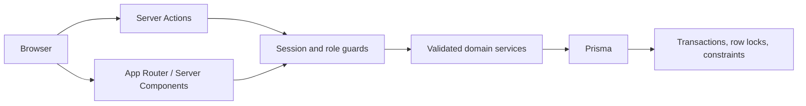

# ReserveFlow

A focused resource reservation app for teams: find a shared space or piece of equipment, reserve it, and keep a clear schedule without double bookings.

Built for the PrimeWave Lab internship assessment. The official brief requires **Next.js App Router, TypeScript, PostgreSQL, Git/GitHub**, a runnable repository, a 3–5 minute demo, and an ER diagram. **Authentication, two roles, resource categories, activation, and cancellation policies are implementation decisions**, rather than additional requirements stated by the company.

## Stack and architecture

- Next.js **16.4.0**, React **19.3.0**, strict TypeScript. Versions were checked against npm's stable tags during implementation; the lockfile pins the install.
- PostgreSQL 16+ (verified locally with **18.3**), Prisma **7.10.0** with its PostgreSQL driver adapter. Prisma 8 was a release candidate at implementation time, so the compatible stable Prisma 7 release is pinned.
- Better Auth **1.7.7**, database-backed expiring sessions, Argon2id hashes.
- Tailwind CSS 4, shadcn-style Radix primitives and Lucide icons; Zod boundary validation; date-fns-tz for Asia/Colombo.
- Vitest domain/database tests and Playwright browser tests.



Server Components query real persistent data. Interactive forms call thin Server Actions. Every service checks the authenticated actor; the browser never supplies authoritative ownership or role. The Next.js backend keeps this small application within a single codebase.

## Features and permissions

| Capability                               | Member                                                     | Administrator                   |
| ---------------------------------------- | ---------------------------------------------------------- | ------------------------------- |
| Manage member accounts, roles and access | No                                                         | Yes (archive preserves history) |
| Browse resources                         | Active resources                                           | All resources                   |
| Add/edit/activate/deactivate resources   | No                                                         | Yes                             |
| Create reservation                       | As self                                                    | As self                         |
| Read/edit/cancel reservations            | Own only                                                   | All                             |
| Dashboard reservation counts             | Own only                                                   | Organization-wide               |
| Resource availability                    | Occupied intervals, without private purposes or identities | Occupied intervals              |

Resource name/category/location/description/capacity, resource search and category filters, reservation search/date/resource/status filters, bounded pagination, availability checks, rescheduling, cancellation confirmations, loading/error/empty states, and responsive navigation are included. Counts always come from PostgreSQL.

## Quick start on this Windows workspace

Prerequisites: **Node 22.18+**, npm, and PostgreSQL **16+** installed. Node 24.8.0 and npm 11.6.0 were used here. The setup script auto-detects Windows PostgreSQL 18/17/16 and common Linux binary directories. Set `PG_BIN` when the binaries are elsewhere. PostgreSQL must run as an ordinary user; the helper does not change system users.

```powershell
npm ci
npm run setup
npm run dev
```

Open **[http://localhost:3000/login](http://localhost:3000/login)** and sign in before opening the dashboard. A "Please sign in to continue" error means the request has no authenticated session; reseeding is not required.

`npm run dev` regenerates the ignored Prisma client before starting Next.js. If another command reports `Can't resolve '@/generated/prisma/client'`, run `npm run db:generate` and retry. Client generation does not migrate, seed, or reset the database.

If startup instead reports missing `@prisma/client/runtime/query_compiler_fast_bg.postgresql.mjs` or its `wasm-base64.mjs` companion, stop the development server and run `npm ci`, then `npm run dev`. These runtime files come from the installed `@prisma/client` package; regenerating the client alone cannot restore an incomplete dependency installation. Keep the committed lockfile. Reinstalling dependencies does not change database records or `.env`.

### Seeded accounts in this local workspace

Only the isolated `LOCAL_POSTGRES=true` cluster on port `54329` provisions these fixed demonstration accounts. Existing PostgreSQL services use a private administrator:

| Role          | Email                      | Password                                                           |
| ------------- | -------------------------- | ------------------------------------------------------------------ |
| Administrator | `admin@reserveflow.local`  | `2c9ce316f45005f0dcdd71c1cb434fde1b6c6915222e026414a9ceed415bf869` |
| Member        | `member@reserveflow.local` | `5b00eb66ee81c3843f448df4379c72bae6a34c7d30187821cb7550734b6d5454` |

These are intentionally published local-demo credentials. Their single definition is `scripts/demo-accounts.mjs`; the seed and local verification tools use it. Seed account passwords are not stored in `.env`. Setup still generates private database passwords and the authentication secret there. The seed refuses remote databases and production mode.

Setup creates an independent cluster in `.local/postgres`, listens only on **127.0.0.1:54329**, and creates `reserveflow` and `reserveflow_test`. It does not modify the existing PostgreSQL system service. It applies all committed migrations, grants the app role limited runtime access, seeds two accounts and six resources, and migrates the test database. The development and preview servers bind to `127.0.0.1` by default.

The seed adds three non-overlapping reservations on the next Sri Lanka calendar day. Rerunning it preserves existing records and password hashes, skips existing demonstration reservations, and does not reset user edits. Administrators can explicitly replace a password from Members > Edit member. To restore the documented passwords on the isolated local demo, run `npm run db:demo-passwords`; this revokes only those two accounts' sessions and preserves their identities and reservations. Regular seeding never resets stored passwords.

```powershell
npm run db:stop     # Stop only the isolated cluster; preserve its data
npm run db:local    # Restart it
npm run db:seed     # Idempotent seed
```

If Better Auth or Prisma reports `P1001` / "Can't reach database server at 127.0.0.1:54329", restart the isolated cluster with `npm run db:local`, then retry the page or sign-in. This cluster does not start automatically after a reboot; `npm run dev` starts only Next.js. For subsequent development sessions, run `npm run db:local` before `npm run dev`. Restarting the cluster retains existing accounts and reservation history.

The local bootstrap owner is a development-only database superuser. The runtime `reserveflow_app` role has no schema-changing privileges or resource/reservation deletion permission. Production provisioning should use a narrowly scoped migration owner with just the necessary extension privileges.

## Using an existing local PostgreSQL server

1. On a PostgreSQL server running on this PC (`localhost` / `127.0.0.1`), create a dedicated empty database (and a separate test database ending in `_test`). Ensure the migration identity can install `btree_gist`.
2. Copy `.env.example` to `.env`, set `LOCAL_POSTGRES=false`, and replace all placeholders with unique private values.
3. Configure `DB_HOST`, `DB_PORT`, `DB_USERNAME`, `DB_PASSWORD`, and `DB_DATABASE`. Local development supports your existing `postgres` login on localhost. Production requires a restricted runtime identity; configure optional `MIGRATION_DB_USERNAME` and `MIGRATION_DB_PASSWORD` for its schema owner. Isolated tests require `TEST_DB_USERNAME`, `TEST_DB_PASSWORD`, and `TEST_DB_DATABASE` ending in `_test`. Passwords are entered as plain values; the shared server-side helper encodes them when constructing the connection string.
4. Run:

```text
npm ci
npm run db:migrate
npm run db:grant
npm run db:seed
npm run db:bootstrap-admin
npm run dev
```

`db:seed` creates public demonstration accounts only for the isolated `LOCAL_POSTGRES=true` cluster on port `54329`. On an existing PostgreSQL server it seeds resources only; set unique `ADMIN_BOOTSTRAP_EMAIL` and `ADMIN_BOOTSTRAP_PASSWORD`, run `npm run db:bootstrap-admin` once, then remove both variables. Bootstrap refuses to create another administrator when one is already active; use Members to manage subsequent accounts. `db:grant` supports both local setup modes and gives the runtime role insert-only access to private `AuditEvent` records and CRUD access to persistent `RateLimit` records. App startup checks actual PostgreSQL permissions and refuses elevated/schema-owner roles or missing required grants. The explicit exception is `DB_USERNAME=postgres` in development with both the database and app origin on loopback hosts; production startup retains every permission check. `db:grant` skips permission changes for this local postgres mode. Apply migrations to the test DB with `DB_TARGET=test` in the command environment, then remove that temporary setting.

| Environment variable                                              | Purpose                                                                                                           |
| ----------------------------------------------------------------- | ----------------------------------------------------------------------------------------------------------------- |
| `DB_HOST`, `DB_PORT`, `DB_USERNAME`, `DB_PASSWORD`, `DB_DATABASE` | Required PostgreSQL fields; read only on the server                                                               |
| `MIGRATION_DB_USERNAME`, `MIGRATION_DB_PASSWORD`                  | Optional migration/maintenance identity; defaults to the main fields                                              |
| `TEST_DB_USERNAME`, `TEST_DB_PASSWORD`, `TEST_DB_DATABASE`        | Explicit non-elevated test identity and local database ending in `_test`                                          |
| `MIGRATION_DB_HOST`, `MIGRATION_DB_PORT`, `MIGRATION_DB_DATABASE` | Optional maintenance target overrides; default to the main fields                                                 |
| `TEST_DB_HOST`, `TEST_DB_PORT`                                    | Optional test server overrides; default to the main fields                                                        |
| `DB_SSL_MODE`, `MIGRATION_DB_SSL_MODE`, `TEST_DB_SSL_MODE`        | `verify-full` required for remote servers; optional locally                                                       |
| `DB_TARGET`                                                       | Temporary `test` target for test migrations; leave unset for the app                                              |
| `BETTER_AUTH_URL`                                                 | Exact app origin, e.g. `http://localhost:3000`; HTTPS in production                                               |
| `BETTER_AUTH_SECRET`                                              | High entropy secret of at least 32 characters                                                                     |
| `NEXT_SERVER_ACTIONS_ENCRYPTION_KEY`                              | Stable base64-encoded 32-byte key shared by all deployed app instances                                            |
| `ADMIN_BOOTSTRAP_EMAIL`, `ADMIN_BOOTSTRAP_PASSWORD`               | One-time private administrator bootstrap; remove after use                                                        |
| `AUTH_TRUSTED_IP_HEADER`                                          | Optional proxy-overwritten `x-real-ip`, `cf-connecting-ip`, or `x-forwarded-for`; see deployment boundaries below |
| `LOCAL_POSTGRES`                                                  | `true` only for the isolated local cluster helper                                                                 |

| `PG_BIN` | Optional directory containing PostgreSQL executables |
| `PLAYWRIGHT_CHANNEL` | Optional installed browser channel such as `chrome` or `msedge` for tests |

The private database configuration uses separate values, for example:

```dotenv
# Database Configuration (PostgreSQL)
DB_HOST=localhost
DB_PORT=5432
DB_USERNAME=postgres
DB_PASSWORD=YOUR_PRIVATE_LOCAL_PASSWORD
DB_DATABASE=reserveflow
```

No database URL environment variable is required. Keep authentication secrets and other app settings in `.env` as well. `npm run build` can compile with local settings, but `npm run start` runs in production and requires the restricted runtime role described above.

For tests, place the `TEST_DB_*` fields in an ignored `.env.test.local` file to keep the main `.env` database section to these five fields. The integration runner loads that file automatically; Prisma loads it only when `DB_TARGET=test`. Explicit terminal environment variables take precedence.

Keep `.env`, `.local`, browser traces, and private credentials out of Git. The explicitly published demonstration account passwords above are public local-demo values. `.env.example` contains placeholders only. There are no `NEXT_PUBLIC_` secrets.

## Members and reusable controls

Administrators can open **Members** to create accounts, search by name/email, filter by role/status, edit details and roles, set an initial or replacement password, deactivate/reactivate, and archive accounts. Passwords are hashed with Argon2id. Archive is a logical deletion using inactive status; the account and all reservations remain in PostgreSQL. Deactivation or changes to role, email, or password revoke existing sessions. Concurrent management operations preserve at least one active administrator. Security-relevant account, resource, and reservation changes create append-only `AuditEvent` records with the actor and before/after snapshots.

Reservation ownership still comes from the signed-in account. Members and administrators create their own reservations; booking forms do not accept `userId` or `role`. Member profiles link to reservation history, and administrators can filter reservations by member, including inactive accounts. Deactivating a member does not cancel or free their confirmed reservations.

`src/config/settings.ts` is the single source for public app settings, navigation visibility, page/selector limits, validation limits, category/role/status options, booking defaults, date formats, locale, and time zone. Resources, members and reservations stay in PostgreSQL. Secrets stay in environment variables and are never imported into this module.

The members list provides labeled View, Edit, and Delete icons. Delete asks for confirmation and archives the account while retaining its reservations; the account remains visible as inactive and can be reactivated. Saving or cancelling an edit returns to the members list. Desktop and mobile sign-out controls ask for confirmation before ending the session.

The shared `SearchableSelect` supports search, arrow keys, Home/End, Enter, Escape, clearing, disabled options, and an empty state. Shared `DatePicker` and `DateTimePicker` retain native date/time editing and form validation while adding a keyboard-accessible calendar with month/year dropdowns, previous/next month buttons, a highlighted current day, and a Today shortcut in Sri Lanka time. Date limits apply to calendar navigation and selection. Arrow keys move between days; Page Up/Down changes the month and Shift+Page Up/Down changes the year. Calendar selection preserves the time in date/time fields. Desktop and mobile forms use the same controls.

## Booking correctness

All timestamps are stored as **TIMESTAMPTZ**. Forms explicitly interpret dates in **Asia/Colombo (UTC+05:30)** and convert them to instants; the same zone is used to display them. Cross-midnight reservations are supported.

Reservations use half-open intervals **`[start,end)`**, so 09:00–10:00 and 10:00–11:00 can coexist. The included SQL migration adds a range `CHECK` and a **GiST exclusion constraint** that prevents overlapping CONFIRMED reservations for the same resource. Cancelled bookings no longer block availability. This remains effective even when writers bypass the service's row lock.

Booking create/edit and resource deactivation serialize against the same resource row using parameterized `FOR UPDATE` queries. Updates/cancellations also lock the reservation row. A conflict rolls back atomically and becomes the safe `SLOT_UNAVAILABLE` message, preserving form inputs and the previous booking.

Policies:

- New reservations start strictly after server time; start must precede end.
- Only future confirmed reservations can be rescheduled. The resource stays fixed; changing resource means cancelling and creating a new reservation.
- Confirmed reservations can be cancelled until their end time. Repeat cancellation is idempotent. Ended reservations cannot be cancelled.
- Inactive resources reject new/rescheduled bookings. Deactivation preserves existing bookings; administrators coordinate or cancel them separately.
- Resources and reservations are never hard-deleted through the app.
- Availability feedback is advisory and is checked again transactionally on confirmation.

**Use `prisma migrate deploy`, never `prisma db push`:** Prisma's schema does not represent the manual exclusion constraint.

## Checks

```text
npm run lint
npm run typecheck
npm run test
npm run test:db
npm run build
npm audit --omit=dev
npm run check:secrets
```

Browser tests use the actual app and PostgreSQL. Playwright starts its own server, so choose a free local port or stop your ReserveFlow development server first. To explicitly reuse a running ReserveFlow server, set `PLAYWRIGHT_REUSE_SERVER=true`; tests verify the login page identity before entering credentials. Install the bundled browser once, or use a locally installed channel:

```powershell
npx playwright install chromium
npm run test:e2e
# Alternatively:
$env:PLAYWRIGHT_CHANNEL = 'chrome'
npm run test:e2e
```

When another application uses port 3000, run the browser suite on another local port:

```powershell
$env:PLAYWRIGHT_BASE_URL = 'http://localhost:3100'
$env:PLAYWRIGHT_CHANNEL = 'msedge'
npm run test:e2e
```

Playwright passes the selected origin to the app's `BETTER_AUTH_URL` for its server process. The private `.env` file stays unchanged. Only local HTTP origins are accepted for browser tests.

The integration configuration requires an explicit local `_test` database, rejects superuser credentials, and refuses aliases of the application database. It deletes only scoped test fixtures. It verifies actual SQL constraints, independent concurrent connections, persistent throttling, service locking, permissions, invalid states, cancellation and conflicting edits. Browser tests create and remove their own resource/bookings in the isolated demo database; use only a local demonstration environment for them. Never run them against production or another person's database.

Recorded results and limitations: [docs/VERIFICATION.md](docs/VERIFICATION.md). Test output is the authority; do not assume a command passed just because it appears here.

## Security model and limits

Better Auth supplies opaque database-backed sessions, signed HttpOnly/SameSite cookies, expiry/refresh, and origin protection. Cookies use Secure when the configured origin uses HTTPS. Public sign-up and identity-management endpoints are closed; only sign-in, sign-out and session retrieval are exposed. Disabled users are rejected on session creation and protected reads. Every protected service checks the user; member ownership scopes are part of database queries. Zod rejects forged ownership/role fields and malformed or oversized booking/resource inputs. React escapes stored text; raw HTML is never rendered.

Next.js Server Actions retain their origin/host protections. The auth route bounds request bodies to 8 KiB; actions to 128 KiB. Basic security headers and a baseline CSP are present. Unexpected failures expose a generic message and log only an error class and trace identifier.

The documented seed account passwords are public and restricted to the isolated `LOCAL_POSTGRES=true` cluster on port `54329`. Existing-server seeding cannot create these accounts. Login throttling uses atomic PostgreSQL counters shared across app instances and restarts. Forwarded-IP headers are ignored by default; requests share a per-path bucket when no trusted IP source exists. Configure `AUTH_TRUSTED_IP_HEADER` only behind a reverse proxy that overwrites that header and prevents direct access to the app origin. A proxy/WAF should also enforce connection and request limits. Database-backed throttling follows the [Better Auth storage guidance](https://better-auth.com/docs/concepts/rate-limit).

Account access/password changes revoke stored sessions and set a cutoff that invalidates logins started before the change. Resource and booking mutations lock/recheck the actor before taking resource/reservation locks, so stale role/account snapshots cannot authorize queued writes. Audit events capture before/after changes and a password-change flag, never passwords/hashes/tokens; the runtime can append them but cannot read, edit, truncate, or delete them. Restricted runtime identities cannot inspect audit history. The local development postgres exception has full database privileges; production retains the restricted permission model.

Non-local app origins require HTTPS; remote database connections require certificate verification with `DB_SSL_MODE=verify-full`. Local HTTP previews remain supported. The CSP runs from `src/proxy.ts`, generates a fresh nonce for every page request, and removes `unsafe-inline`/`unsafe-eval` in production. The root nonce bridge supplies the original document nonce to Radix's scroll-lock stylesheet library across client navigation. Only React streaming's exact `display:none` style attribute is hash-allowed. New UI libraries require browser checks against this policy. HSTS is emitted only for configured HTTPS production origins. Deploy a private-account installation behind HTTPS; override the default loopback binding explicitly when the reverse proxy requires it (`npm run start -- --hostname 0.0.0.0`) and protect that origin at the network boundary. Supply only runtime credentials to deployed app processes; keep migration, test, and bootstrap credentials in separate administrative/CI environments.

This is a local technical assessment, **not an audited production platform**. External TLS/proxy hosting, email identity verification, password recovery, MFA, operational alerting, backup restoration, and audit-retention operations are not included. Limits on resource selectors/availability schedules keep reads bounded; a larger organization would need searchable server-side selectors.

The npm audit and pinned override decisions are documented in the verification report. Do not run `npm audit fix --force` blindly: it proposes incompatible framework/tooling downgrades for some transitive findings.

## Repository map

```text
src/app/                  Protected pages, login, auth routes, server actions
src/components/           Shell, forms, cards, tables, Radix UI primitives
src/lib/auth/             Better Auth, password hashing, current-user guards
src/config/settings.ts    Public UI, navigation, pagination, date and dropdown configuration
src/lib/services/         Resource, reservation, member, and dashboard business logic
src/lib/db/               Server-only Prisma client
src/lib/validators/       Zod boundary schemas
src/lib/time/             Sri Lanka time conversion and interval semantics
prisma/                   Actual schema, SQL migrations, idempotent seed
scripts/                  Safe isolated local PostgreSQL setup
tests/                    Domain, real PostgreSQL, and browser verification
docs/                     ER diagram, demo script, and verification evidence
ReserveFlow-Prompts/      Original assessment specifications, preserved
```

ER diagram: [rendered diagram and constraints](docs/ERD.md), [Mermaid source](docs/erd.mmd), [SVG](docs/erd.svg). Demo: [4:30 recording script](docs/DEMO.md). Submission handoff: [docs/SUBMISSION.md](docs/SUBMISSION.md).

Screenshots from actual local data: [overview](docs/screenshots/overview.png), [resource directory](docs/screenshots/resources.png), [mobile](docs/screenshots/mobile.png). A local **4:11** captioned recording is in `artifacts/reserveflow-demo.webm` (ignored by Git); review it before uploading. It has no audio narration. See the demo document for the repeatable recording command.

Charts, email, billing, recurrence, integrations, multi-tenancy, external deployment, and calendar month views are deliberately deferred. A focused functional reservation workflow is the priority.

Primary implementation references: [Next.js installation](https://nextjs.org/docs/app/getting-started/installation), [Better Auth Next.js integration](https://better-auth.com/docs/integrations/next), [Better Auth password hashing](https://better-auth.com/docs/authentication/email-password), [Prisma 7 configuration](https://www.prisma.io/docs/guides/upgrade-prisma-orm/v7).
