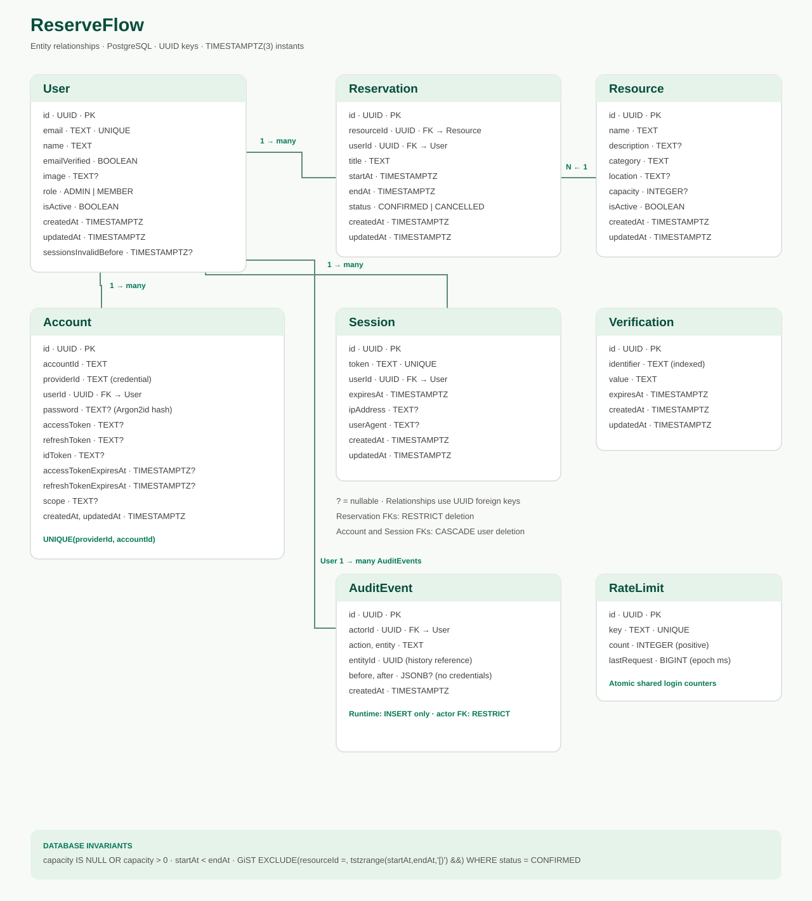

# Actual database schema

The full Mermaid representation is in [erd.mmd](erd.mmd). It includes all six actual tables, including the authentication library's Account, Session and Verification tables. Password hashes live in `Account.password` rather than being duplicated on User. Verification is part of Better Auth's schema; no email verification/recovery flow is enabled in this app.

User and Resource each have a one-to-many relationship with Reservation. Account and Session belong to User. Reservation foreign keys restrict deletion; authentication foreign keys cascade on user deletion. The application provides no user or reservation hard-delete flow.

Database integrity rules:

- Resource capacity is nullable or strictly positive.
- Reservation start precedes end.
- `reservation_no_overlap_confirmed`: GiST exclusion on `(resourceId, tstzrange(startAt,endAt,'[)'))` for CONFIRMED rows.
- `timestamptz(3)` is used for instants. New-booking future-time rules are checked against server time in the service, since a static CHECK cannot reliably represent changing `now()`.
- Indexes cover member/date and resource/date queries, status/date, and resource activation/category. Unique indexes protect user emails, session tokens, and account provider/account combinations.

For submission, push this repository to an approved GitHub remote and link to this file or the raw SVG. No public URL has been created or verified by the local implementation.
