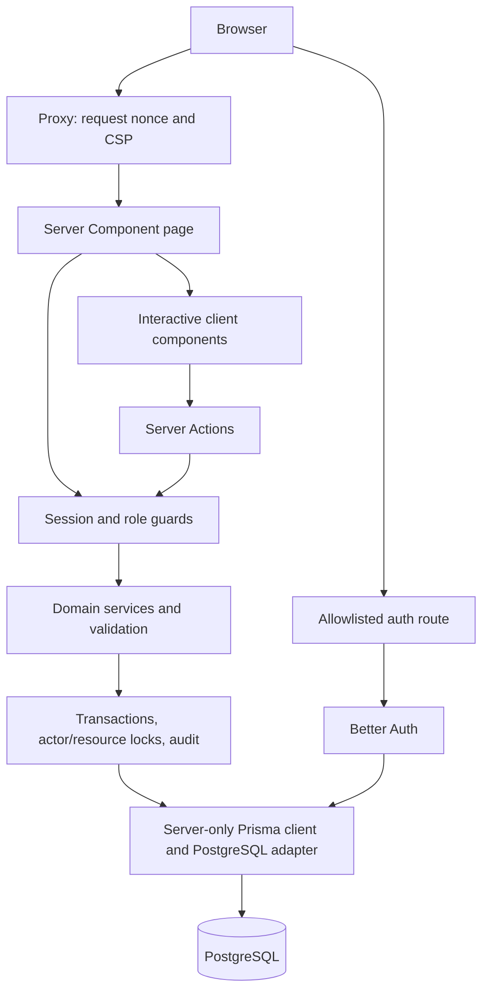
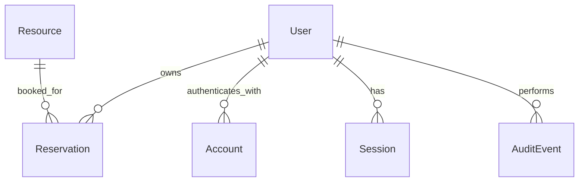

# ReserveFlow: complete project guide

**Studied:** 13 October 2026, Asia/Colombo. **Source baseline:** commit `0c92799`.

This is a detailed explanation of the project as implemented in this checkout. It covers the product, each application layer, individual database fields, exported operations, routes, controls, configuration, scripts, tests, and every tracked file. It is intended for learning, maintenance, interviews, and handoff.

The study used the repository's authored source, schema, all five SQL migrations, package manifests and lockfile, configuration, tests, and existing documentation. The baseline contains **134 tracked files**, **eight application database tables**, **six unit-test files**, and **three database integration suites**. Dependency source, generated Prisma code, private environment values, local database contents, and generated browser/video artifacts are not reproduced here. Public demonstration passwords are also left in their existing documentation rather than copied into this guide.

The `ReserveFlow-Prompts` directory referenced by `AGENTS.md` and README is absent from this checkout. Assessment requirements below therefore describe what the README records; they are not a new verification of the missing original brief. Source code is the authority for implemented behavior. Dated test results are in [VERIFICATION.md](VERIFICATION.md).

## Contents

1. [Purpose and scope](#1-purpose-and-scope)
2. [Technology and dependencies](#2-technology-and-dependencies)
3. [Architecture and startup](#3-architecture-and-startup)
4. [Roles and permissions](#4-roles-and-permissions)
5. [Pages and routes](#5-pages-and-routes)
6. [End-to-end user workflows](#6-end-to-end-user-workflows)
7. [Server Actions](#7-server-actions)
8. [Service function reference](#8-service-function-reference)
9. [Database schema: every field](#9-database-schema-every-field)
10. [Relationships, indexes, and migrations](#10-relationships-indexes-and-migrations)
11. [Booking correctness and concurrency](#11-booking-correctness-and-concurrency)
12. [Validation and error contracts](#12-validation-and-error-contracts)
13. [Time and calendar behavior](#13-time-and-calendar-behavior)
14. [Authentication and session lifecycle](#14-authentication-and-session-lifecycle)
15. [Security controls and database permissions](#15-security-controls-and-database-permissions)
16. [Interface and component reference](#16-interface-and-component-reference)
17. [Public settings and policy constants](#17-public-settings-and-policy-constants)
18. [Environment configuration](#18-environment-configuration)
19. [Setup and database operations](#19-setup-and-database-operations)
20. [Seed data and maintenance scripts](#20-seed-data-and-maintenance-scripts)
21. [Commands and build configuration](#21-commands-and-build-configuration)
22. [Test coverage and verification](#22-test-coverage-and-verification)
23. [Troubleshooting](#23-troubleshooting)
24. [Limitations and source observations](#24-limitations-and-source-observations)
25. [Making future changes](#25-making-future-changes)
26. [Complete tracked-file index](#26-complete-tracked-file-index)
27. [Glossary and suggested reading order](#27-glossary-and-suggested-reading-order)

## 1. Purpose and scope

ReserveFlow manages reservations for shared resources in a team. A resource can be a room, workspace, piece of equipment, vehicle, or other shared item. A reservation records who booked it, the purpose, the start and end instants, and whether it remains confirmed or has been cancelled.

The main problem is preventing two confirmed bookings from occupying the same resource at overlapping times. Related problems are keeping availability understandable, limiting changes to authorized users, and retaining history after cancellation, resource deactivation, or account deactivation.

The README records the PrimeWave Lab internship assessment's required stack and deliverables as Next.js App Router, TypeScript, PostgreSQL, Git/GitHub, a runnable repository, an ER diagram, and a three-to-five-minute demonstration. Authentication, two roles, categories, activation, auditing, and cancellation policies are project decisions added around that brief.

Implemented features include sign-in/sign-out, a database-backed overview, resource browsing and management, personal or organization-wide reservation history, advisory availability checks, booking creation/rescheduling/cancellation, administrator-managed accounts, search and filters, pagination, mobile navigation, keyboard controls, and help/error/loading/empty states.

There is one workspace and one database-backed application. The schema has no organization or tenant identifier. There is no payment, recurrence, approval queue, public registration, email recovery, or external calendar integration.

Important product distinctions:

- A resource's **active** flag determines whether it accepts new/rescheduled reservations.
- **Available now** describes current occupancy, not whether a future slot is free.
- **Confirmed** and **Cancelled** are stored statuses. **In progress** and **Completed** are display labels calculated from current time.
- Account archive means setting `isActive=false`; it does not remove the identity or release its reservations.
- Capacity describes a resource. It does not allow multiple simultaneous bookings up to that capacity.

## 2. Technology and dependencies

Versions below are the versions resolved in the committed lockfile at the studied baseline, not claims about registry releases.

| Technology                               | Locked version | Responsibility                                                                                           |
| ---------------------------------------- | -------------- | -------------------------------------------------------------------------------------------------------- |
| Next.js                                  | 16.4.0         | App Router, Server Components, Server Actions, route handlers, Proxy, build/dev server                   |
| React / React DOM                        | 19.3.0         | Server/client UI and browser hydration                                                                   |
| TypeScript                               | 5.9.3          | Strict source checking; no emitted application JS from the standalone typecheck                          |
| Prisma CLI / client / PostgreSQL adapter | 7.10.0         | Schema/client generation, committed migrations, typed database operations, PostgreSQL driver integration |
| `pg`                                     | 8.23.1         | PostgreSQL connections for the adapter and maintenance/testing scripts                                   |
| Better Auth                              | 1.7.7          | Credential sign-in, sessions, cookies, origin checks, persistent authentication throttling               |
| `@node-rs/argon2`                        | 2.2.2          | Native Argon2id password hashing and verification                                                        |
| Zod                                      | 4.6.6          | Boundary validation, strict objects, field errors                                                        |
| Tailwind CSS                             | 4.3.3          | Utility styles and the global theme                                                                      |
| `date-fns`                               | 4.4.0          | Calendar date arithmetic and date formatting                                                             |
| `date-fns-tz`                            | 3.2.0          | Explicit Asia/Colombo wall-time/instant conversion                                                       |
| Vitest                                   | 4.1.11         | Unit and isolated PostgreSQL tests                                                                       |
| Playwright test                          | 1.64.0         | Real browser workflows, assertions, screenshots, local recording                                         |
| ESLint                                   | 9.39.5         | Next.js/TypeScript source linting                                                                        |

Other direct runtime dependencies have specific, limited jobs:

| Package                    | Use                                                                                  |
| -------------------------- | ------------------------------------------------------------------------------------ |
| `@radix-ui/react-dialog`   | Accessible dialog primitives used by confirmations, mobile navigation, and calendars |
| `@radix-ui/react-slot`     | Allows the shared Button to style a child link through `asChild`                     |
| `class-variance-authority` | Named button variants and sizes                                                      |
| `clsx`                     | Conditional class composition                                                        |
| `tailwind-merge`           | Resolves conflicting Tailwind classes through `cn`                                   |
| `lucide-react`             | UI icons and category illustrations                                                  |
| `dotenv`                   | Environment loading outside the Next.js runtime                                      |
| `get-nonce`                | Supplies the original document's CSP nonce to library-injected styles                |
| `server-only`              | Marks database/auth/service modules as unavailable to client imports                 |

Development tooling also includes Next's ESLint configuration, Prettier, `tsx` for TypeScript scripts, Tailwind's PostCSS plugin, and Node/React/PostgreSQL type packages. The package uses ESM through `"type": "module"` and requires Node **22.18.0 or newer**. README records Node 24.8.0, npm 11.6.0, and PostgreSQL 18.3 in earlier local verification; PostgreSQL 16+ is the stated prerequisite.

`package.json` pins the framework/auth/Prisma packages but uses ranges for several other dependencies. `package-lock.json` resolves those ranges. Overrides pin `deepmerge-ts` to 8.0.2 and `mysql2` to 3.24.5 for transitive tooling findings. MySQL is not the application database.

## 3. Architecture and startup



### 3.1 Responsibilities by layer

| Layer                  | Main files                             | What it owns                                                                                 |
| ---------------------- | -------------------------------------- | -------------------------------------------------------------------------------------------- |
| Pages/layouts          | `src/app`                              | Authenticate page access, read services, assemble server-rendered UI                         |
| Client components      | `src/components` and `src/hooks`       | Form state, dialogs, calendars, pending/error feedback, browser navigation                   |
| Server Actions         | `src/app/actions.ts`                   | Dispatch mutations, return safe result objects, revalidate affected layouts                  |
| Auth                   | `src/lib/auth`                         | Session lookup, fresh user state, role guards, password algorithms, transaction actor checks |
| Services               | `src/lib/services`                     | Business rules, ownership scopes, database queries, locks, atomic audit records              |
| Validators/errors      | `src/lib/validators`, `src/lib/errors` | Input contracts and public error contracts                                                   |
| Database configuration | `src/lib/db`                           | Private field validation, URL construction, client singleton, startup permissions            |
| SQL                    | `prisma/migrations`                    | Tables, indexes, referential integrity, CHECK constraints, exclusion constraint              |
| Scripts                | `scripts` and `prisma/seed.ts`         | Local setup and explicit maintenance outside browser flows                                   |

There is no separate Express API server and no client-side ORM. Client forms invoke Server Actions rather than constructing their own database requests. Auth is the main conventional HTTP API; resource/member/reservation operations use pages and actions.

### 3.2 Startup sequence

1. `npm run dev` first runs `predev`, which generates the ignored Prisma client.
2. Next.js loads `next.config.ts` and root environment files.
3. The Node.js instrumentation hook's `register` export imports `assertRuntimePermissions`.
4. The database client validates private `DB_*` settings and creates `PrismaClient` with `PrismaPg`.
5. A real PostgreSQL query checks the runtime identity's privileges. Missing schema/connection problems can also fail at this stage.
6. The local postgres development exception or restricted-role policy determines whether startup can proceed.
7. Requests pass through `src/proxy.ts`, then the App Router.

`src/lib/db/index.ts` stores a client on `globalThis.reserveflowDb` outside production to avoid repeated clients during development reloads. Application modules importing it retain the `server-only` boundary.

### 3.3 Rendering and navigation

`src/app/layout.tsx` calls `connection()` to wait for a request, reads the injected `x-nonce` header, and renders the nonce bridge. It sets English document language, page-title templates, and application description. The main data pages render dynamically rather than being exported as static snapshots.

The protected route-group layout calls `requirePageUser` and passes a safe name/email/role view to `AppShell`. Pages/services still perform their own checks. Authentication is not delegated to a hidden navigation item or to the layout alone.

Dynamic pages await `params` and `searchParams`, reflecting the installed Next.js conventions. Parenthesized groups such as `(protected)` and `(auth)` organize files; their names do not appear in public URLs.

## 4. Roles and permissions

Application roles are the `Role` enum values **ADMIN** and **MEMBER**. PostgreSQL login roles such as a runtime role, migration owner, test owner, or postgres are separate database identities.

| Operation                                                           | Member                                                    | Administrator                                    |
| ------------------------------------------------------------------- | --------------------------------------------------------- | ------------------------------------------------ |
| Sign in                                                             | Active account only                                       | Active account only                              |
| Browse/get resources                                                | Active resources only                                     | Active and inactive resources                    |
| Create/edit/activate resources                                      | Denied                                                    | Allowed                                          |
| Create reservation                                                  | Own signed-in identity                                    | Own signed-in identity                           |
| Read/reschedule/cancel reservation                                  | Own records only                                          | All records, subject to booking state rules      |
| Filter reservations by member                                       | Denied                                                    | Allowed, including inactive members              |
| View occupied resource intervals                                    | Active resource intervals without private booking details | Authorized resource intervals                    |
| Reservation dashboard metrics                                       | Own reservations                                          | All reservations                                 |
| Resource dashboard metrics                                          | Shared active resources                                   | Shared active resources                          |
| Create/edit/archive accounts                                        | Denied                                                    | Allowed, while retaining an active administrator |
| Read password hashes, account tokens, or sessions through member UI | Denied                                                    | Denied                                           |

`requireUser` and `requireAdmin` throw business errors for service/action access. `requirePageUser` redirects to `/login`; `requirePageAdmin` redirects members to `/`. Resource create/edit pages use `notFound()` for authenticated non-administrators. Unauthorized ownership queries return no record, producing the same unavailable-page experience as a missing reservation.

Booking payloads never accept authoritative `userId`, `role`, or a chosen booking owner. Administrators can filter or manage another member's existing reservation but the booking form does not create bookings on someone else's behalf.

## 5. Pages and routes

| Public URL                | Source under `src/app`                        | Access and behavior                                                                            |
| ------------------------- | --------------------------------------------- | ---------------------------------------------------------------------------------------------- |
| `/login`                  | `(auth)/login/page.tsx`                       | Sign-in; an already authenticated user redirects to `/`                                        |
| `/`                       | `(protected)/page.tsx`                        | Overview with live counts, upcoming reservations, resource categories                          |
| `/help`                   | `(protected)/help/page.tsx`                   | Authenticated instructions, booking/time/account policies                                      |
| `/resources`              | `(protected)/resources/page.tsx`              | Search/category filters, resource cards, current availability, pagination                      |
| `/resources/new`          | `(protected)/resources/new/page.tsx`          | Administrator resource form; others receive not-found                                          |
| `/resources/[id]`         | `(protected)/resources/[id]/page.tsx`         | Resource details, active state, bounded occupied-time schedule, role-specific actions          |
| `/resources/[id]/edit`    | `(protected)/resources/[id]/edit/page.tsx`    | Administrator edit; invalid/missing record maps to not-found                                   |
| `/reservations`           | `(protected)/reservations/page.tsx`           | Scoped history; purpose/resource search, resource/status/date filters, admin member filter     |
| `/reservations/new`       | `(protected)/reservations/new/page.tsx`       | Active-resource selector, optional validated `resourceId` query selection, future default time |
| `/reservations/[id]`      | `(protected)/reservations/[id]/page.tsx`      | Authorized detail, derived state, full start/end dates, conditional reschedule/cancel controls |
| `/reservations/[id]/edit` | `(protected)/reservations/[id]/edit/page.tsx` | Requires future CONFIRMED booking and active resource; otherwise not-found                     |
| `/members`                | `(protected)/members/page.tsx`                | Admin-only search by name/email, role/status filtering, counts, View/Edit/Delete icons         |
| `/members/new`            | `(protected)/members/new/page.tsx`            | Admin-only account creation                                                                    |
| `/members/[id]`           | `(protected)/members/[id]/page.tsx`           | Admin-only account profile, reservation-history link, access/archive controls                  |
| `/members/[id]/edit`      | `(protected)/members/[id]/edit/page.tsx`      | Admin-only name/email/role/status/password edit                                                |
| `/api/auth/get-session`   | `api/auth/[...all]/route.ts`                  | GET session retrieval through Better Auth                                                      |
| `/api/auth/sign-in/email` | `api/auth/[...all]/route.ts`                  | POST credential sign-in, bounded body, origin/rate checks                                      |
| `/api/auth/sign-out`      | `api/auth/[...all]/route.ts`                  | POST sign-out                                                                                  |
| `/icon.svg`               | `icon.svg`                                    | Static application icon                                                                        |

The catch-all auth route does not expose arbitrary Better Auth operations. Other GET/POST identity paths return HTTP 403. Public signup is explicitly unavailable.

List pages catch invalid filter parsing and display `FilterError` with a clear-filters link. Detail pages use `pageRecord` to turn malformed identifiers or service NOT_FOUND errors into Next's not-found flow. Other failures reach the page error boundary.

`(protected)/loading.tsx` supplies loading skeletons with a status label. `(protected)/error.tsx` provides a generic retry UI. Root `not-found.tsx` provides the unavailable-page message. `global-error.tsx` is the root fallback that owns its own HTML/body when the normal root layout cannot render.

## 6. End-to-end user workflows

### 6.1 Sign in and browse

1. An unauthenticated protected request redirects to `/login`.
2. `LoginForm` sends normalized lowercase email and the password through `authClient.signIn.email` with `rememberMe:false`.
3. Better Auth verifies the credential hash and account-access/cutoff state, applies persistent throttling, and creates a database-backed session.
4. The browser receives the session cookie and navigates to `/`.
5. On protected reads, `currentUser` retrieves the session and separately fetches the current User's role and access state.
6. Resource search submits a GET form to `/resources`; filters are reflected in the URL and applied by the service.

### 6.2 Create a reservation

1. A user selects an active resource and enters a purpose and start/end wall times.
2. The form sends only `{resourceId, title, startAt, endAt}`.
3. An optional check reports whether any confirmed range overlaps; this result is advisory.
4. `saveReservationAction` invokes `createReservation`.
5. The service authenticates the user, validates the payload, converts times, and rejects a past/nonfuture start.
6. Inside a transaction, it locks/rechecks the actor, locks the resource, checks activity and time again, and inserts using the signed-in user's ID.
7. PostgreSQL accepts the range or rejects an overlap through the exclusion constraint.
8. An audit INSERT occurs in the same transaction. Any failure rolls back both booking and audit work.
9. The action revalidates the affected layouts and returns the record ID. The form navigates to the reservation detail.

### 6.3 Reschedule

The edit page supplies only the existing resource and disables resource selection. The service also enforces the unchanged resource; disabling a control is not relied upon for security.

A reschedule locks the actor, resource, and reservation, rereads the scoped booking, and requires it to remain future and CONFIRMED. It rejects an inactive resource. A conflicting update rolls back, leaving the original reservation range intact. A successful edit keeps the same reservation ID and owner and writes before/after audit snapshots.

### 6.4 Cancel

The user opens a confirmation dialog. The service locks the actor, resource, and booking, then changes CONFIRMED to CANCELLED while `endAt` is still in the future. An in-progress booking may be cancelled; an ended confirmed booking may not.

Already cancelled records return unchanged, making repeat cancellation idempotent. Cancellation permits an inactive resource and frees the exclusion-constrained slot without deleting the row. There is no reservation reactivation operation.

### 6.5 Manage resources

An administrator creates or edits metadata using `ResourceForm`. Resource creation defaults to active through the schema; activation is a separate action. Edits and status changes recheck admin authority under the actor lock and lock the resource row.

Deactivation blocks subsequent new/rescheduled bookings and retains existing reservations. It does not silently cancel a booked user's plans. Administrators can still inspect inactive resource details and coordinate or cancel reservations separately.

### 6.6 Manage members

An administrator creates a User and credential Account atomically. Passwords are hashed before storage; the returned member shape contains no credential/session objects.

Editing can change name, email, application role, active status, and optionally password. A blank replacement password preserves the current hash. Password/email/role changes or inactive access revoke sessions and update the cutoff. Name-only edits do not trigger that revocation rule.

Saving an existing member or cancelling the form returns to `/members`; creating a member opens the new profile. The form clears the password field after each attempted submission.

The members-list Delete icon opens the archive confirmation. Archive deactivates the account, retains its email uniqueness and reservations, and supports later reactivation. No distinct `archivedAt` field exists; archived accounts appear as inactive.

### 6.7 Sign out

Desktop and mobile controls open a dialog first. Cancelling keeps the session. Confirming calls Better Auth sign-out and navigates to `/login`. The pending state prevents duplicate confirmations; the nested mobile navigation dialog remains usable after cancelling sign-out.

## 7. Server Actions

Source: [src/app/actions.ts](../src/app/actions.ts). This file is marked `"use server"`.

| Export                    | Input                                | Service path                   | Successful result                                                      |
| ------------------------- | ------------------------------------ | ------------------------------ | ---------------------------------------------------------------------- |
| `saveResourceAction`      | Nullable ID, unknown payload         | Create or update resource      | ID and created/updated message                                         |
| `resourceStatusAction`    | ID, active boolean                   | `setResourceActive`            | ID and status message, including reservation retention on deactivation |
| `saveReservationAction`   | Nullable ID, unknown payload         | Create or update reservation   | ID and confirmed/updated message                                       |
| `cancelReservationAction` | Reservation ID                       | `cancelReservation`            | ID and cancellation/slot-availability message                          |
| `availabilityAction`      | Nullable booking ID, unknown payload | New or edit availability check | `available` boolean and advisory/conflict message                      |
| `saveMemberAction`        | Nullable ID, unknown payload         | Create or update member        | ID and created/updated message                                         |
| `memberStatusAction`      | ID, active boolean                   | `setMemberActive`              | ID and activation/deactivation message                                 |
| `archiveMemberAction`     | Member ID                            | `archiveMember`                | ID and history-retention message                                       |

The private `mutate` wrapper calls `requireUser`, runs the service, calls `refresh`, and catches failures through `publicError`. The services independently authorize the actual operation. `refresh` revalidates `/`, `/resources`, `/reservations`, and `/members` with layout scope. Availability uses its own read/error wrapper and does not perform that mutation refresh.

Result contracts are:

```ts
type Success = { ok: true; id?: string; message: string };
type Failure = {
  ok: false;
  code: ErrorCode;
  message: string;
  fields?: Record<string, string[]>;
};
// availabilityAction can also include available?: boolean.
```

The ID argument is not trusted merely because it came from a rendered page. Services parse IDs and impose role/ownership scopes. Service validation accepts `unknown` inputs to keep that trust boundary explicit.

## 8. Service function reference

### 8.1 Resource service

Source: [resources.ts](../src/lib/services/resources.ts).

| Function                     | Exact responsibility                                                                                                                                                                                |
| ---------------------------- | --------------------------------------------------------------------------------------------------------------------------------------------------------------------------------------------------- |
| `listResources`              | Authenticates, reparses filters, scopes members to active resources, applies category and case-insensitive name/location/description search, paginates, returns matching count and all-active count |
| `resourceOptions`            | Authenticated active-resource ID/name/category choices, alphabetical, maximum 500                                                                                                                   |
| `reservationResourceOptions` | Admins get all resources; members get active resources plus inactive resources linked to their own history, maximum 500                                                                             |
| `getResource`                | Validated UUID and member-active scope; throws NOT_FOUND for missing/inaccessible resource                                                                                                          |
| `createResource`             | Admin check, strict metadata validation, actor lock/recheck, resource insert and audit in one transaction                                                                                           |
| `updateResource`             | Admin check, validated ID/payload, actor lock then resource FOR UPDATE, metadata update plus before/after audit                                                                                     |
| `setResourceActive`          | Admin check, strict boolean check, actor/resource locks, activation update plus audit                                                                                                               |

The list orders active resources first, then name. Current occupancy checks for a CONFIRMED reservation satisfying `startAt <= now` and `endAt > now`, selecting at most one ID. It returns `isAvailable = isActive && no current reservation`; private purpose/owner fields are not part of that occupancy result.

### 8.2 Reservation service

Source: [reservations.ts](../src/lib/services/reservations.ts).

| Function                  | Exact responsibility                                                                                                                                                 |
| ------------------------- | -------------------------------------------------------------------------------------------------------------------------------------------------------------------- |
| `listReservations`        | Authenticates, validates filters, applies member ownership/admin member filter, status/resource/search/day-overlap filters, counts and paginates, newest start first |
| `getReservation`          | Validates ID, includes member ownership in the query, returns resource plus owner's name, otherwise NOT_FOUND                                                        |
| `createReservation`       | Strict booking payload, future start, actor/resource locks, authenticated ownership, booking insert and audit                                                        |
| `updateReservation`       | Locked actor's current role determines ownership scope; forbids resource changes; locks/rechecks booking state; future range update and audit                        |
| `cancelReservation`       | Ownership scope from locked actor; resource lock accepts inactivity; booking lock; idempotent cancellation before end                                                |
| `checkAvailability`       | Authenticated validated future range, active accessible resource, boolean overlap lookup                                                                             |
| `checkEditAvailability`   | Authorized existing booking, unchanged resource and future proposed start, active resource, overlap lookup excluding the same booking ID                             |
| `resourceSchedule`        | Authorized resource lookup, CONFIRMED occupied intervals with future end and start within the next seven rolling days, at most 30, oldest start first                |
| `ReservationWithResource` | Type for the reservation query payload including resource and safe user-name relation                                                                                |

`listReservations` searches both purpose/title and resource name. A selected date means any booking overlapping that Sri Lanka calendar day, including a booking that started the previous day. The resource schedule exposes only `startAt` and `endAt`; it does not return other users' purposes, names, or reservation IDs.

Private helpers include `future`, `lockResource`, the common relation include, and `auditSnapshot`. `future` is checked again after waiting for a lock where a new/rescheduled start could have become invalid.

### 8.3 Member service

Source: [members.ts](../src/lib/services/members.ts).

| Function          | Exact responsibility                                                                                                                           |
| ----------------- | ---------------------------------------------------------------------------------------------------------------------------------------------- |
| `listMembers`     | Admin-only name/email search, role/status filters, safe select, reservation count, stable name/ID ordering, pagination                         |
| `getMember`       | Admin-only validated ID, safe member select, NOT_FOUND when absent                                                                             |
| `memberOptions`   | Admin-only ID/name/activity choices; includes inactive members, maximum 500                                                                    |
| `createMember`    | Required initial password, hash, advisory management lock and admin actor recheck, atomic User/Account/audit creation                          |
| `updateMember`    | Validate/hash optional password, management serialization, last-admin protection, optional account upsert, session cutoff/deletion, safe audit |
| `setMemberActive` | Strict boolean, management serialization and last-admin protection, access update, deactivation cutoff/session deletion, audit                 |
| `archiveMember`   | Calls `setMemberActive(id,false,"MEMBER_ARCHIVE")`; logical deletion                                                                           |

The safe select includes `id`, `name`, `email`, `role`, `isActive`, `createdAt`, and reservation count. It excludes Account and Session relations. A duplicate-email Prisma `P2002` becomes a VALIDATION_ERROR instead of exposing the database exception.

`lockManagement` acquires transaction advisory lock key 724091 before locking/rechecking the administrator. `protectAdmin` rejects demotion/deactivation of an active admin when no other active admin remains. `auditSnapshot` deliberately omits credentials. Updates record a boolean `passwordChanged`, not a password or hash.

### 8.4 Dashboard, audit, and page adapters

| Function       | Source                    | Responsibility                                                                                               |
| -------------- | ------------------------- | ------------------------------------------------------------------------------------------------------------ |
| `getDashboard` | `services/dashboard.ts`   | Authenticates and runs seven bounded/count/group queries concurrently                                        |
| `recordAudit`  | `services/audit.ts`       | Parameterized audit INSERT with a generated UUID and optional JSON snapshots inside the caller's transaction |
| `pageRecord`   | `services/page-record.ts` | Converts Zod and NOT_FOUND failures into `notFound()`; rethrows other failures                               |

Dashboard definitions are precise:

| Returned value    | Query meaning                                                                                                     |
| ----------------- | ----------------------------------------------------------------------------------------------------------------- |
| `activeResources` | All resources with `isActive=true`                                                                                |
| `availableNow`    | Active resources with no CONFIRMED interval covering the current instant                                          |
| `todayBookings`   | Scoped CONFIRMED reservations overlapping the current Sri Lanka day; not limited to starts today or future starts |
| `upcomingCount`   | Scoped CONFIRMED reservations whose start is strictly after now                                                   |
| `cancelledCount`  | All scoped CANCELLED reservations, with no date restriction                                                       |
| `upcoming`        | Up to five scoped CONFIRMED reservations whose end is after now, ordered by start; can include an ongoing booking |
| `categories`      | Active resources grouped/counts by category, category ascending                                                   |
| `user`, `now`     | Safe actor and the server instant used by the read                                                                |

Each count comes from PostgreSQL. The parallel dashboard queries are not wrapped in one snapshot transaction, so concurrent changes may occur between individual reads.

`recordAudit` uses INSERT without RETURNING because returning rows would require SELECT access to private audit data. A write-only runtime identity can therefore record events without reading historical snapshots.

## 9. Database schema: every field

Sources: [schema.prisma](../prisma/schema.prisma) and [SQL migrations](../prisma/migrations). The schema uses the `prisma-client` generator with output `src/generated/prisma` and the PostgreSQL datasource. Connection settings belong to `prisma.config.ts`, not a URL in the schema.

All eight models have a UUID primary-key `id`. Prisma's `uuid()` defaults generate model IDs; the initial SQL does not supply a database UUID default for every raw INSERT. Code that bypasses Prisma must supply required IDs and other required columns itself.

`DateTime @db.Timestamptz(3)` means an instant stored with millisecond precision. `createdAt @default(now())` maps to creation-time defaults. `updatedAt @updatedAt` is maintained by Prisma writes; it is not a general database trigger that updates arbitrary raw SQL.

### 9.1 User

| Field                   | Type / nullability              | Default or rule                  | Meaning                                                                              |
| ----------------------- | ------------------------------- | -------------------------------- | ------------------------------------------------------------------------------------ |
| `id`                    | UUID, required                  | Primary key; Prisma UUID default | Stable account identity and booking owner                                            |
| `email`                 | String/TEXT, required           | Unique                           | Normalized lowercase by member/bootstrap flows                                       |
| `name`                  | String/TEXT, required           | No schema default                | Display name                                                                         |
| `emailVerified`         | Boolean, required               | false                            | Better Auth field; managed accounts are created verified; no verification-email flow |
| `image`                 | String/TEXT, nullable           | No default                       | Auth profile image slot; no account-image management UI                              |
| `role`                  | Role enum, required             | MEMBER                           | Application authorization role                                                       |
| `isActive`              | Boolean, required               | true                             | Whether the account can use the workspace                                            |
| `sessionsInvalidBefore` | TIMESTAMPTZ(3), nullable        | No default                       | Revocation cutoff for old sessions and logins begun before access/credential changes |
| `createdAt`             | TIMESTAMPTZ(3), required        | now                              | Creation instant                                                                     |
| `updatedAt`             | TIMESTAMPTZ(3), required        | Prisma update timestamp          | Last Prisma-managed update                                                           |
| `reservations`          | Reservation relation collection | Via `Reservation.userId`         | All owned booking history                                                            |
| `accounts`              | Account relation collection     | Via `Account.userId`             | Credentials/provider data                                                            |
| `sessions`              | Session relation collection     | Via `Session.userId`             | Database-backed sessions                                                             |
| `auditEvents`           | AuditEvent relation collection  | Named `AuditActor` relation      | Events performed by this user                                                        |

### 9.2 Resource

| Field          | Type / nullability       | Default or rule                                            | Meaning                  |
| -------------- | ------------------------ | ---------------------------------------------------------- | ------------------------ |
| `id`           | UUID, required           | Primary key; UUID default                                  | Stable resource identity |
| `name`         | TEXT, required           | Validated 2–100 characters in services                     | Searchable display name  |
| `description`  | TEXT, nullable           | Up to 1,000 characters in services                         | Facilities/instructions  |
| `category`     | TEXT, required           | Service validates the category list                        | Grouping; not a SQL enum |
| `location`     | TEXT, nullable           | Up to 160 characters in services                           | Human-readable location  |
| `capacity`     | Integer, nullable        | SQL CHECK permits null or positive; service caps at 10,000 | Descriptive capacity     |
| `isActive`     | Boolean, required        | true                                                       | Booking eligibility      |
| `createdAt`    | TIMESTAMPTZ(3), required | now                                                        | Creation instant         |
| `updatedAt`    | TIMESTAMPTZ(3), required | Prisma-managed                                             | Last update              |
| `reservations` | Reservation collection   | Via `resourceId`                                           | Resource booking history |

### 9.3 Reservation

| Field        | Type / nullability               | Default or rule                                           | Meaning                                                 |
| ------------ | -------------------------------- | --------------------------------------------------------- | ------------------------------------------------------- |
| `id`         | UUID, required                   | Primary key; UUID default                                 | Booking identity retained through edits/cancellation    |
| `resourceId` | UUID, required                   | Resource FK, deletion restricted                          | Booked resource; cannot change in a service reschedule  |
| `userId`     | UUID, required                   | User FK, deletion restricted                              | Owner derived from the signed-in actor on create        |
| `title`      | TEXT, required                   | Service validates 3–160 characters                        | Purpose of reservation                                  |
| `startAt`    | TIMESTAMPTZ(3), required         | Strictly before end; new starts must be future in service | Start instant                                           |
| `endAt`      | TIMESTAMPTZ(3), required         | Strictly after start                                      | Exclusive end instant                                   |
| `status`     | ReservationStatus enum, required | CONFIRMED                                                 | CONFIRMED or CANCELLED                                  |
| `createdAt`  | TIMESTAMPTZ(3), required         | now                                                       | Original creation instant                               |
| `updatedAt`  | TIMESTAMPTZ(3), required         | Prisma-managed                                            | Latest change instant                                   |
| `resource`   | Resource relation                | `resourceId`                                              | Full resource metadata in authorized queries            |
| `user`       | User relation                    | `userId`                                                  | Query includes only owner name for reservation displays |

### 9.4 Account

| Field                   | Type / nullability       | Rule / purpose                                                                            |
| ----------------------- | ------------------------ | ----------------------------------------------------------------------------------------- |
| `id`                    | UUID, required           | Primary key; UUID default                                                                 |
| `accountId`             | TEXT, required           | For local credential accounts, the user ID represented as the provider account identifier |
| `providerId`            | TEXT, required           | `credential` in the implemented member/bootstrap/seed flows                               |
| `userId`                | UUID, required           | User FK; authentication data cascades on an actual user deletion                          |
| `password`              | TEXT, nullable           | Encoded Argon2id hash; never plaintext                                                    |
| `accessToken`           | TEXT, nullable           | Better Auth provider-compatible field; no social-provider flow configured                 |
| `refreshToken`          | TEXT, nullable           | Provider-compatible field                                                                 |
| `idToken`               | TEXT, nullable           | Provider-compatible field                                                                 |
| `accessTokenExpiresAt`  | TIMESTAMPTZ(3), nullable | Provider token expiry slot                                                                |
| `refreshTokenExpiresAt` | TIMESTAMPTZ(3), nullable | Provider token expiry slot                                                                |
| `scope`                 | TEXT, nullable           | Provider scope slot                                                                       |
| `createdAt`             | TIMESTAMPTZ(3), required | now                                                                                       |
| `updatedAt`             | TIMESTAMPTZ(3), required | Prisma-managed                                                                            |
| `user`                  | User relation            | Credential owner                                                                          |

`providerId` plus `accountId` is unique. Password hashes are not duplicated in User.

### 9.5 Session

| Field       | Type / nullability       | Rule / purpose                                                          |
| ----------- | ------------------------ | ----------------------------------------------------------------------- |
| `id`        | UUID, required           | Primary key; UUID default                                               |
| `token`     | TEXT, required           | Unique opaque session token                                             |
| `expiresAt` | TIMESTAMPTZ(3), required | Session expiry supplied by authentication                               |
| `createdAt` | TIMESTAMPTZ(3), required | Creation timestamp; sign-in hook can anchor it to login-start time      |
| `updatedAt` | TIMESTAMPTZ(3), required | Prisma-managed update                                                   |
| `ipAddress` | TEXT, nullable           | Auth metadata; trusted-header configuration controls accepted IP source |
| `userAgent` | TEXT, nullable           | Auth client metadata                                                    |
| `userId`    | UUID, required           | User FK with cascade                                                    |
| `user`      | User relation            | Session owner                                                           |

### 9.6 Verification

| Field        | Type / nullability       | Rule / purpose                  |
| ------------ | ------------------------ | ------------------------------- |
| `id`         | UUID, required           | Primary key; UUID default       |
| `identifier` | TEXT, required           | Indexed verification identifier |
| `value`      | TEXT, required           | Verification payload            |
| `expiresAt`  | TIMESTAMPTZ(3), required | Expiry                          |
| `createdAt`  | TIMESTAMPTZ(3), required | now                             |
| `updatedAt`  | TIMESTAMPTZ(3), required | Prisma-managed                  |

This is a Better Auth supporting table. It has no User FK. Its presence does not imply that email verification or password recovery is enabled.

### 9.7 AuditEvent

| Field       | Type / nullability       | Rule / purpose                                                                |
| ----------- | ------------------------ | ----------------------------------------------------------------------------- |
| `id`        | UUID, required           | Primary key; service explicitly generates UUID for raw INSERT                 |
| `actorId`   | UUID, required           | User FK with restricted deletion; who performed the operation                 |
| `action`    | TEXT, required           | Named action such as RESERVATION_CREATE or MEMBER_ARCHIVE                     |
| `entity`    | TEXT, required           | USER, RESOURCE, or RESERVATION in implemented events                          |
| `entityId`  | UUID, required           | ID of affected entity; generic reference, not a polymorphic SQL FK            |
| `before`    | JSONB, nullable          | Previous safe snapshot                                                        |
| `after`     | JSONB, nullable          | Resulting safe snapshot                                                       |
| `createdAt` | TIMESTAMPTZ(3), required | now; no `updatedAt` field because events are append-only under runtime grants |
| `actor`     | User relation            | Named AuditActor relation                                                     |

Resource snapshots contain metadata/activity. Reservation snapshots contain IDs, owner, purpose, ISO start/end, and status. Member snapshots contain identity/name/email/role/activity; updates can include `passwordChanged:boolean`. Credentials, hashes, tokens, and sessions are not included.

Implemented event names are `RESOURCE_CREATE`, `RESOURCE_UPDATE`, `RESOURCE_ACTIVATE`, `RESOURCE_DEACTIVATE`, `RESERVATION_CREATE`, `RESERVATION_UPDATE`, `RESERVATION_CANCEL`, `MEMBER_CREATE`, `MEMBER_UPDATE`, `MEMBER_STATUS_CHANGE`, `MEMBER_ARCHIVE`, and `ADMIN_BOOTSTRAP`.

### 9.8 RateLimit

| Field         | Type / nullability      | Rule / purpose                                    |
| ------------- | ----------------------- | ------------------------------------------------- |
| `id`          | UUID, required          | Primary key; UUID generation through auth/adapter |
| `key`         | TEXT, required          | Unique client/path bucket key                     |
| `count`       | Integer, required       | SQL CHECK requires count > 0                      |
| `lastRequest` | BigInt/BIGINT, required | Epoch-millisecond request timestamp, indexed      |

RateLimit has no User relation. Throttling must also apply to attempts that have not authenticated a user.

## 10. Relationships, indexes, and migrations

### 10.1 Relationships



`Verification` and `RateLimit` have no foreign-key edges. A resource or user may have zero or many reservations. Each reservation belongs to exactly one resource and one user. A user may have multiple account/session/audit rows.

| Foreign key            | Delete action | Update action | Consequence                                          |
| ---------------------- | ------------- | ------------- | ---------------------------------------------------- |
| Reservation → Resource | RESTRICT      | CASCADE       | A referenced resource cannot be physically removed   |
| Reservation → User     | RESTRICT      | CASCADE       | Booking owner identity is retained                   |
| AuditEvent → User      | RESTRICT      | CASCADE       | Audited actor identity is retained                   |
| Account → User         | CASCADE       | CASCADE       | Actual user removal would remove related credentials |
| Session → User         | CASCADE       | CASCADE       | Actual user removal would remove related sessions    |

The application has no user/resource/reservation hard-delete action. Scoped test/demo cleanup uses maintenance identities outside application services; that is not an application deletion feature.

### 10.2 Index reference

In addition to primary-key indexes, the migrations create these indexes:

| Index / columns                                            | Type     | Purpose                          |
| ---------------------------------------------------------- | -------- | -------------------------------- |
| `User_email_key` — email                                   | Unique   | Prevent duplicate account email  |
| `Session_token_key` — token                                | Unique   | Session lookup/integrity         |
| `Session_userId_idx` — userId                              | Ordinary | Session revocation by user       |
| `Account_providerId_accountId_key` — providerId, accountId | Unique   | One provider/account combination |
| `Account_userId_idx` — userId                              | Ordinary | User credentials                 |
| `Verification_identifier_idx` — identifier                 | Ordinary | Verification lookup              |
| `Resource_isActive_category_idx` — isActive, category      | Ordinary | Activity/category access         |
| `Reservation_userId_startAt_idx` — userId, startAt         | Ordinary | Owner/date history               |
| `Reservation_resourceId_startAt_idx` — resourceId, startAt | Ordinary | Resource schedule                |
| `Reservation_status_startAt_idx` — status, startAt         | Ordinary | Status/date reads                |
| `AuditEvent_entity_entityId_createdAt_idx`                 | Ordinary | Entity audit history             |
| `AuditEvent_actorId_createdAt_idx`                         | Ordinary | Actor audit history              |
| `RateLimit_key_key` — key                                  | Unique   | Shared counter identity          |
| `RateLimit_lastRequest_idx` — lastRequest                  | Ordinary | Time-based counter access        |

The booking exclusion constraint additionally has its own GiST backing index. Search currently uses case-insensitive `contains`, not a dedicated full-text/trigram index.

### 10.3 Migration history

| Committed migration                      | Changes                                                                                                                              |
| ---------------------------------------- | ------------------------------------------------------------------------------------------------------------------------------------ |
| `202610110001_initial`                   | Public schema, Role/ReservationStatus enums, User/Account/Session/Verification/Resource/Reservation tables, original indexes and FKs |
| `202610110002_booking_integrity`         | `btree_gist` extension; positive capacity CHECK; valid reservation range CHECK; confirmed-booking exclusion                          |
| `202610120001_security_audit`            | AuditEvent table, actor FK, two audit indexes                                                                                        |
| `202610120002_persistent_rate_limits`    | RateLimit table, positive-count CHECK, unique key and request-time index                                                             |
| `202610120003_session_revocation_cutoff` | Nullable User.sessionsInvalidBefore timestamp                                                                                        |

`migration_lock.toml` fixes the migration provider to PostgreSQL. `prisma migrate deploy` applies this history. **Do not use `prisma db push`:** the Prisma schema alone does not describe the handwritten exclusion constraint or all CHECK constraints.

The important SQL from the integrity migration is:

```sql
CREATE EXTENSION IF NOT EXISTS btree_gist;

ALTER TABLE "Resource" ADD CONSTRAINT "resource_positive_capacity"
  CHECK ("capacity" IS NULL OR "capacity" > 0);

ALTER TABLE "Reservation" ADD CONSTRAINT "reservation_valid_range"
  CHECK ("startAt" < "endAt");

ALTER TABLE "Reservation" ADD CONSTRAINT "reservation_no_overlap_confirmed"
  EXCLUDE USING gist (
    "resourceId" WITH =,
    tstzrange("startAt", "endAt", '[)') WITH &&
  ) WHERE ("status" = 'CONFIRMED');
```

Static SQL constraints enforce capacity positivity, range validity, and overlaps. Future-start policy belongs to the service because the meaning of “future” changes with time. Service-only character/category limits are not equivalent to database constraints; maintenance SQL is a separate trusted boundary.

## 11. Booking correctness and concurrency

### 11.1 Half-open intervals

A booking occupies `[startAt,endAt)`: the start is included and the end is excluded. Two ranges overlap when:

```text
existing.startAt < proposed.endAt
AND existing.endAt > proposed.startAt
```

| Existing resource/time        | Proposed resource/time        | Outcome                                                     |
| ----------------------------- | ----------------------------- | ----------------------------------------------------------- |
| Room A, 09:00–10:00           | Room A, 09:30–10:30           | Conflict                                                    |
| Room A, 09:00–10:00           | Room A, 10:00–11:00           | Allowed adjacency                                           |
| Room A, 09:00–10:00           | Room B, 09:30–10:30           | Allowed different resource                                  |
| Room A, cancelled 09:00–10:00 | Room A, confirmed 09:00–10:00 | Allowed; cancelled rows are outside the exclusion condition |

Availability is not a temporary hold. Another user can book after a successful check and before confirmation. The transactional insert/update and SQL exclusion remain authoritative.

### 11.2 Lock order

Resource and reservation write services follow this ordering:

```text
authenticate and parse
→ begin transaction
→ User actor FOR SHARE, recheck activity/admin role
→ Resource FOR UPDATE
→ Reservation FOR UPDATE when changing an existing booking
→ reread state, check policy, write row, append audit
→ commit
```

`lockActor` uses a parameterized UUID query and returns the actor's current `id`, `role`, and `isActive`. An account update conflicts with the shared actor-row lock, preventing queued mutations from using an earlier deactivated/demoted snapshot.

Creation and resource deactivation both lock the same Resource row. If booking commits first, deactivation preserves it. If deactivation commits first, the later booking sees inactivity and fails. Both outcomes retain a consistent history.

Reschedule/cancel look up a scoped original booking to find its resource, then acquire resource and reservation locks and reread the scoped booking before deciding. The current locked actor's role determines whether the update can reach another user's record.

Member-management transactions acquire the global advisory management lock first, then recheck/lock the administrator. The same management key is used by private administrator bootstrap. It serializes last-admin decisions so two concurrent requests cannot independently remove both remaining administrators.

The implementation does not configure a special transaction isolation level or a generic transaction retry loop. It uses explicit locks plus PostgreSQL constraints for the particular invariants.

### 11.3 State rules

| Current state                                      | Create                                 | Reschedule                                        | Cancel                                             |
| -------------------------------------------------- | -------------------------------------- | ------------------------------------------------- | -------------------------------------------------- |
| No booking, active resource, proposed future start | Allowed if range free                  | Not applicable                                    | Not applicable                                     |
| Future CONFIRMED booking, active resource          | Separate creation subject to exclusion | Allowed with same resource and valid future range | Allowed                                            |
| In-progress CONFIRMED booking                      | Separate creation subject to policy    | Denied                                            | Allowed until its end                              |
| Ended CONFIRMED booking                            | Separate future creation allowed       | Denied                                            | Denied                                             |
| CANCELLED booking                                  | New future booking may use its slot    | Denied                                            | Returns existing cancelled record                  |
| Inactive resource                                  | Denied                                 | Denied                                            | Existing authorized booking may still be cancelled |

No code converts CONFIRMED to a stored COMPLETED value. The confirmed row remains history after its end. An administrator remains subject to future-time/range/state rules; admin status does not make invalid time ranges valid.

### 11.4 Atomic failure behavior

An overlap raises PostgreSQL SQLSTATE `23P01`, sometimes wrapped by the Prisma driver adapter. `isExclusionViolation` checks stable codes, the named constraint, and nested `cause`, `meta`, or `driverAdapterError` objects. `publicError` returns `SLOT_UNAVAILABLE` with the safe conflict message.

An unsuccessful update leaves the previous range in place. An unsuccessful audit INSERT rolls back the booking/resource/member mutation as part of the same transaction. There is no partial “confirmed booking without its service audit” commit.

## 12. Validation and error contracts

Source: [validators/index.ts](../src/lib/validators/index.ts). Resource, reservation, member, and filter objects use strict Zod schemas. Unknown payload properties are rejected at the service boundary.

### 12.1 Individual schemas

| Export              | Rules and transformations                                                                                                                       |
| ------------------- | ----------------------------------------------------------------------------------------------------------------------------------------------- |
| `idSchema`          | String UUID; safe invalid-record message                                                                                                        |
| `resourceSchema`    | Name trimmed, 2–100; category enum; optional description/location trimmed and blank-to-null; capacity null or bounded positive integer          |
| `reservationSchema` | Resource UUID; trimmed purpose 3–160; exact local minute timestamp strings, real-date round trip, conversion to Date; start strictly before end |
| `filtersSchema`     | Bounded search/page; allowed categories/statuses/roles/activity values; optional UUID filters; validated local calendar date; defaults          |
| `parseFilters`      | Copies only recognized query keys, then parses; known keys supplied as arrays fail the expected scalar shape                                    |
| `memberSchema`      | Trimmed name 2–100; trimmed valid email ≤254 and lowercase; role enum; boolean activity; blank or 12–128-character password                     |
| `newMemberSchema`   | Member rules plus required initial password of at least 12 characters                                                                           |
| `activeSchema`      | A real boolean, not a coerced string                                                                                                            |

Capacity accepts an empty string, an integer number, or a digit-only string that becomes an integer. Empty capacity becomes null. Booleans, arrays, arbitrary objects, fractions, negative values, zero, and values above 10,000 fail.

Timestamp input must match `YYYY-MM-DDTHH:mm`. The validator converts it and converts back to ensure impossible dates such as 30 February do not slip through normalization. No offset or arbitrary ISO-format payload is accepted in that booking field.

### 12.2 Filter fields

| Key          | Default      | Allowed value / use                                        |
| ------------ | ------------ | ---------------------------------------------------------- |
| `q`          | Empty string | Trimmed search up to 100 characters                        |
| `category`   | Empty string | One of the configured categories                           |
| `status`     | Empty string | CONFIRMED or CANCELLED                                     |
| `memberId`   | Empty string | UUID; reservation service permits it only for admins       |
| `role`       | Empty string | ADMIN or MEMBER; member list                               |
| `active`     | Empty string | `active` or `inactive`; member list                        |
| `resourceId` | Empty string | UUID; reservation list                                     |
| `date`       | Empty string | Real `YYYY-MM-DD` Sri Lanka calendar date                  |
| `page`       | 1            | Integer 1–10,000; bounded digit strings can become numbers |

Services use the subset relevant to their list. Resource listing uses search/category and member activity scoping; it does not implement the `active` member-filter field as a resource-state filter. Unrecognized URL keys are omitted by `parseFilters`, while strict service payload objects reject unrecognized properties.

### 12.3 Error codes

| Code                | Typical cause                                                                |
| ------------------- | ---------------------------------------------------------------------------- |
| `UNAUTHENTICATED`   | Missing/invalid session or inactive locked actor                             |
| `FORBIDDEN`         | Missing admin role; member-only request to filter by another member          |
| `NOT_FOUND`         | Missing UUID record or ownership/activity scope hides it                     |
| `VALIDATION_ERROR`  | Zod field problem, nonfuture start, duplicate email, resource-change attempt |
| `RESOURCE_INACTIVE` | New/rescheduled booking on inactive resource                                 |
| `SLOT_UNAVAILABLE`  | Overlapping confirmed booking                                                |
| `INVALID_STATE`     | Illegal reschedule/cancel or removal of the last active administrator        |
| `INTERNAL_ERROR`    | Unexpected failure with generic public message                               |

Zod failures return flattened per-field string arrays plus a generic “check the highlighted fields” message. Known AppError messages are returned as intended business feedback. Unexpected action failures log only an error class and random trace ID, then return a generic retry message; input payloads and full database errors are not deliberately returned.

`RequestBodyError` is a separate HTTP-route error with 400, 408, or 413 status. Authentication-handler failures become a generic 503. Invalid/disallowed identity endpoints return 403.

## 13. Time and calendar behavior

The product uses **Asia/Colombo**, with a displayed offset of **UTC+05:30**. Database timestamps represent instants. User booking strings represent Sri Lanka wall time regardless of the browser's own timezone.

An existing unit test checks that `2030-10-12T09:00` becomes `2030-10-12T03:30:00.000Z` and converts back. UTC midnight and Sri Lanka calendar midnight differ; date filters and dashboard day counts use the configured zone.

### 13.1 Time helper exports

| Function               | Behavior                                                                               |
| ---------------------- | -------------------------------------------------------------------------------------- |
| `fromLocalInput`       | `fromZonedTime(value, TIME_ZONE)` → Date instant                                       |
| `toLocalInput`         | Zone-specific `yyyy-MM-dd'T'HH:mm` for inputs                                          |
| `formatDate`           | Format an instant in the shared zone; defaults to configured date format               |
| `formatTime`           | Configured `h:mm a` display                                                            |
| `nextReservationStart` | Now plus 60-minute lead, rounded up to a 30-minute boundary, converted to local input  |
| `dayBounds`            | Local midnight and that instant plus 24 hours                                          |
| `overlaps`             | Strict half-open overlap predicate used in domain tests                                |
| `calendarDate`         | Validates complete date-only input using parse/format round trip; returns Date or null |
| `calendarDays`         | Builds 42 days beginning on the Monday of the displayed month's first calendar week    |

Date-only calendar calculations use calendar helpers rather than treating a selected date as a UTC instant. Cross-midnight reservations are permitted. Details show full start/end dates; table rows include the end date when it differs from the start date.

### 13.2 Display formats

| Setting             | Pattern              |
| ------------------- | -------------------- |
| `input`             | `yyyy-MM-dd'T'HH:mm` |
| `dateInput`         | `yyyy-MM-dd`         |
| `date`              | `EEE, d MMM`         |
| `time`              | `h:mm a`             |
| `month`             | `MMMM yyyy`          |
| `full`              | `d MMMM yyyy`        |
| `shortMonth`        | `MMM`                |
| `day`               | `dd`                 |
| `weekday`           | `EEEE`               |
| `weekdayInitial`    | `EEEEE`              |
| `shortDate`         | `d MMM`              |
| `dateWithYear`      | `EEE, d MMM yyyy`    |
| `shortDateWithYear` | `d MMM yyyy`         |

The configured one-hour duration and one-hour lead are UI defaults, not a minimum advance-booking/duration policy. The service requires a strictly future start and valid range but does not set a maximum booking duration or maximum advance horizon.

## 14. Authentication and session lifecycle

### 14.1 Better Auth configuration

Source: [auth/index.ts](../src/lib/auth/index.ts).

- Prisma adapter uses PostgreSQL and transactions.
- Email/password authentication is enabled; public signup is disabled.
- Role and activity are additional user fields with `input:false`, preventing public auth inputs from setting them.
- Session expiry is 24 hours; update age is one hour; cookie-cache optimization is disabled.
- Auth-generated identifiers use UUIDs.
- Cookies use HttpOnly and SameSite=Lax; Secure is enabled for HTTPS configured origins.
- Trusted origins contain the validated application origin.
- Authentication rate limiting stores counters in PostgreSQL.

The password module configures Argon2 algorithm 2 (Argon2id), memory cost 65,536, time cost 3, parallelism 1, and output length 32. `hashPassword` and `verifyPassword` wrap the native library with those settings.

### 14.2 Session/user guards

| Export             | Behavior                                                                                            |
| ------------------ | --------------------------------------------------------------------------------------------------- |
| `currentUser`      | React request-cached session lookup plus current database User selection; returns safe user or null |
| `requireUser`      | Requires safe current user; otherwise UNAUTHENTICATED                                               |
| `requirePageUser`  | Redirects unauthenticated page requests to `/login`                                                 |
| `requireAdmin`     | Requires authenticated ADMIN; otherwise FORBIDDEN                                                   |
| `requirePageAdmin` | Redirects authenticated non-admin to `/`                                                            |
| `lockActor`        | Transactional FOR SHARE lookup/recheck; optional admin requirement                                  |
| `authClient`       | Browser Better Auth client, with no database credentials or Prisma client                           |

`currentUser` checks activity and session creation time against `sessionsInvalidBefore`; it does not trust a previously issued cookie to contain an authoritative current role. React `cache` avoids repeated identical lookups within the request rendering context, while mutation services recheck the actor under a database lock.

### 14.3 Password/access-change race

A login can begin verifying an old password immediately before an administrator changes it. Deleting existing sessions alone would not stop that already-running login from creating a later session.

The before-sign-in hook records server-owned `signInStartedAt`. Before session creation, the user is read again. Session creation fails if the user is inactive or the anchored creation/login-start time is at or before the cutoff. Guards independently reject older sessions as well. A real-auth integration test pauses password verification, performs a reset/cutoff change, resumes verification, and requires a 401 with no session.

Administrative member updates set the cutoff and delete that user's sessions when password/email/role changes or access is inactive. Deactivation sets it too; reactivation preserves the existing cutoff. Name-only changes and an empty password do not independently require a reset.

The dedicated demo-password reset script has a narrower implementation: it updates the two known credential hashes and deletes their sessions, but does not run the member service or update the cutoff. See the maintenance limitations in section 24.

## 15. Security controls and database permissions

### 15.1 Boundaries around HTTP and forms

Next.js Server Actions retain framework origin/host protections. Better Auth applies its origin protection to allowlisted identity operations. Strict schemas reject forged booking ownership/role fields. Resource and member services check admin role; members' reservation queries include ownership directly.

SQL statements carrying IDs and snapshot values use Prisma tagged parameterization. The grant/local-provisioning scripts separately quote SQL identifiers and use PostgreSQL `format` for role/password provisioning rather than accepting SQL identifiers from booking forms.

React displays stored text as text; the browser security scenario stores a script-shaped purpose and verifies it does not execute. No arbitrary rich HTML feature is implemented.

### 15.2 Body and rate limits

| Control                            | Implemented limit               |
| ---------------------------------- | ------------------------------- |
| Auth request body                  | 8,192 bytes                     |
| Auth body read deadline            | 10,000 ms                       |
| Server Action body                 | 128 KiB configuration (`128kb`) |
| Default authentication rate window | 60 seconds                      |
| Default auth requests per window   | 30                              |
| Email sign-in requests per window  | 5                               |

`boundedBody` checks Content-Length when present and also counts streamed chunks, so omitting a header does not remove the limit. It cancels on oversize/timeout and releases the reader. The route passes the already bounded body to Better Auth instead of cloning an unbounded stream. Allowed auth responses and handled body/server failures use `Cache-Control:no-store`.

Forwarded-IP headers are ignored by default. `AUTH_TRUSTED_IP_HEADER` optionally accepts `x-real-ip`, `cf-connecting-ip`, or `x-forwarded-for`. This setting assumes a proxy that overwrites the header and prevents direct client access to the origin. Without a trusted source, authentication requests share a per-path client bucket; the test's key is `127.0.0.1|/sign-in/email`.

### 15.3 CSP and other headers

`src/proxy.ts` replaces incoming CSP/nonce headers with a fresh random nonce and applies the resulting policy to the request and response. Its matcher excludes `_next/static`, `_next/image`, and `favicon.ico`.

| CSP directive               | Behavior                                                                             |
| --------------------------- | ------------------------------------------------------------------------------------ |
| `default-src`               | Self                                                                                 |
| `script-src`                | Self, per-request nonce, strict-dynamic; unsafe-eval added only for development      |
| `style-src`                 | Self; unsafe-inline only in development, nonce in other modes                        |
| `style-src-attr`            | Outside development, hash allowance for React streaming's exact `display:none` style |
| `img-src`                   | Self, data, blob                                                                     |
| `font-src`, `connect-src`   | Self                                                                                 |
| `object-src`                | None                                                                                 |
| `base-uri`, `form-action`   | Self                                                                                 |
| `frame-ancestors`           | None                                                                                 |
| `upgrade-insecure-requests` | Outside development when the configured app origin is HTTPS                          |

`CspNonce` remembers the initial document nonce with a ref and supplies it via `get-nonce`. Client navigation can fetch an RSC response carrying a new nonce, but the browser document still has its original policy; retaining the original avoids mismatched library style nonces.

`next.config.ts` adds nosniff, strict-origin-when-cross-origin referrer policy, DENY framing, a permissions policy denying camera/microphone/geolocation, same-origin opener/resource policies, disabled DNS prefetch, and no permitted cross-domain policies. HSTS (`max-age=63072000; includeSubDomains`) is emitted only for HTTPS production configuration. The X-Powered-By header and development indicators are disabled.

### 15.4 Restricted runtime grants

| Database object                      | Restricted runtime grants      |
| ------------------------------------ | ------------------------------ |
| Application database                 | CONNECT                        |
| Public schema                        | USAGE; no CREATE               |
| User, Account, Resource, Reservation | SELECT, INSERT, UPDATE         |
| Session, Verification, RateLimit     | SELECT, INSERT, UPDATE, DELETE |
| AuditEvent                           | INSERT only                    |
| Sequences                            | USAGE                          |

The grant helper revokes broad PUBLIC/database/schema/table privileges before applying the required grants inside a transaction. It requires separate runtime/migration roles on the same database, rejects an elevated target runtime role, and enforces the isolated host/port when local-cluster mode is enabled.

Startup checks actual inherited role privileges, table ownership, schema/database CREATE, User/Resource/Reservation DELETE/TRUNCATE, AuditEvent UPDATE/DELETE/TRUNCATE, audit INSERT, and RateLimit CRUD. Superuser, create-role/database, replication, bypass-RLS, and server-file/program roles are considered elevated.

The explicit local exception requires `NODE_ENV=development`, a loopback DB host, `DB_USERNAME=postgres`, a loopback HTTP/HTTPS application origin, and no test target. It queries permissions first, then permits that development identity. This identity has full PostgreSQL privileges, including historical/audit access; restricted-role promises do not apply to that exception. Production startup still rejects excessive privileges.

`db:grant` skips changes in the corresponding local postgres mode; outside that mode, owner/runtime grants must be configured correctly. The grant script defaults an unset NODE_ENV to development for this local maintenance decision.

### 15.5 Private configuration handling

`DB_*` and authentication secrets are read server-side and never use `NEXT_PUBLIC_` names. Public settings contain only UI/domain constants. `.gitignore` excludes `.env*` except `.env.example`, `.local`, generated clients/builds, browser output, logs, and recordings.

The secret scanner compares configured private values of at least 12 characters against Git-visible source and `.next/static` JS/JSON/maps; it also reads test secrets from `.env.test.local`. It separately checks that deliberately public demo passwords do not appear in browser bundles. It is a configured-value check, not a complete detector of every possible unknown/short secret.

## 16. Interface and component reference

### 16.1 Styling and layout

`globals.css` imports Tailwind, defines Segoe UI/Arial/Helvetica system fonts, sets a pale background and stone text, supplies emerald focus outlines, and reduces motion when requested. No remote font service or resource-photo service is required.

Category visuals are CSS grids/orbits and Lucide icons, not fetched images. Workspace uses a warm tone, equipment a blue tone, vehicle a brown tone, other a purple tone, and meeting rooms the default green. Compact visuals are 40×40; full resource visuals are 145 px high. The app icon is a local SVG.

The desktop shell has a fixed 240 px sidebar at the `lg` breakpoint, a header, main content up to 1440 px, and a footer. Mobile navigation uses a dialog. Search in the header submits to the resource directory. Admin-only navigation comes from settings, while server checks remain authoritative. A skip-to-content link and labeled navigation improve keyboard access.

### 16.2 Feature components

| Component           | Responsibility and state                                                                                                                       |
| ------------------- | ---------------------------------------------------------------------------------------------------------------------------------------------- |
| `LoginForm`         | Email/password fields, show/hide password, pending state, 429/generic error text, sign-in navigation                                           |
| `AppShell`, `Brand` | Safe-user navigation, role label, initials, desktop/mobile shell, shared search/time labels                                                    |
| `SignOutButton`     | Confirmation, pending/error state, sign-out and login redirect                                                                                 |
| `ResourceForm`      | Five metadata fields, native/client validation, field errors, action dispatch, redirect to detail on save                                      |
| `ResourceCard`      | Metadata preview, current available/in-use/inactive badge, detail and active-resource reserve links                                            |
| `ResourceVisual`    | Category-specific decorative icons/CSS; marked aria-hidden                                                                                     |
| `ReservationForm`   | Controlled resource/purpose/start/end values, check/save pending states, retained input on failure, advisory feedback, fixed resource on edits |
| `ReservationTable`  | Authorized booking rows, derived time/status labels, cross-midnight end date, optional admin owner column, detail links                        |
| `MemberForm`        | Name/email/role/status/password fields; create/update action; clears password after attempt; existing edits return to list                     |

`useHydrated` uses `useSyncExternalStore` with false server snapshot and true client snapshot. Forms/interactive controls use it to prevent an edit or submit before React is ready. Resource/reservation/member fieldsets disable while saving; reservation editing also disables during availability checks. Login disables its submit until ready/pending, rather than disabling all its inputs.

Changing a reservation resource/time clears advisory availability and error state. Changing only purpose clears the save result; the time-based availability remains relevant. For a blank purpose in the availability request, the form supplies `Availability check` so a time check can still satisfy the purpose schema.

### 16.3 Reusable UI exports

| Export                                                                                        | Contract                                                                                                                   |
| --------------------------------------------------------------------------------------------- | -------------------------------------------------------------------------------------------------------------------------- |
| `Button`, `buttonVariants`                                                                    | `default`, `outline`, `ghost`, `destructive`; `default`, `sm`, `lg`, `icon` sizes; optional `asChild`                      |
| `Dialog`, `DialogTrigger`, `DialogTitle`, `DialogDescription`, `DialogClose`, `DialogContent` | Radix wrappers, portal/overlay, constrained width, labeled close button                                                    |
| `Field`, `inputClass`                                                                         | Label, optional hint/error arrays, shared input styling; errors use `<name>-error` IDs                                     |
| `PageHeading`                                                                                 | Optional eyebrow, title, description, action                                                                               |
| `EmptyState`                                                                                  | Title, explanation, optional action                                                                                        |
| `FilterError`                                                                                 | Invalid-filter empty state and route-specific clear link                                                                   |
| `StatusBadge`                                                                                 | Label plus green/amber/neutral tone                                                                                        |
| `Pagination`                                                                                  | Count/range, previous/next links, preservation of nonempty filters in URL                                                  |
| `ConfirmAction`                                                                               | Resource toggle, reservation cancellation, member toggle, member archive; pending/result/dialog state                      |
| `SearchableSelect`, `SelectOption`                                                            | Searchable bounded in-memory options, controlled/default values, hidden submitted value, required/disabled/clearable state |
| `DatePicker`, `DateTimePicker`                                                                | Native input plus calendar dialog, controlled/default values, min/max/required/disabled and ARIA props                     |
| `CspNonce`                                                                                    | No visible UI; retains original document nonce for generated styles                                                        |

`ConfirmAction` keeps a pending dialog from closing through its state callback. Archive's icon-only label says Delete while its action retains history. Successful actions refresh the router; failures display their safe message.

### 16.4 SearchableSelect mechanics

The visible text input is a combobox; a hidden input carries the selected value for FormData. Filtering uses locale-aware lowercase labels. Required selections use custom validity; disabled options cannot be chosen. The selected label and the current search query are separate states.

| Key / interaction          | Effect                                        |
| -------------------------- | --------------------------------------------- |
| Arrow Down / Arrow Up      | Open and move through enabled choices         |
| Home / End while open      | First/last enabled choice                     |
| Enter while open           | Choose active value                           |
| Escape                     | Close and reset query                         |
| Tab / focus leaving widget | Close/reset query                             |
| Clear button               | Choose empty value when clearing is available |
| No matching options        | Accessible “No options found” status          |

The widget sets combobox/listbox/option roles, selected/disabled state, aria-controls, and active-descendant. It scrolls the active option into view. Searching does not query the server; services already bounded the available option list.

### 16.5 Calendar mechanics

The calendar opens in a Radix dialog, focuses the selected/bounded day, and renders six Monday-start weeks with outside-month days. Current day, selected day, and unavailable days have distinct styling. Month/year selectors, previous/next month, and Today are available. A change from leap-year 29 February to a non-leap year uses date arithmetic that yields a valid day.

| Key                           | Effect                                |
| ----------------------------- | ------------------------------------- |
| Left / Right                  | Previous/next day                     |
| Up / Down                     | Previous/next week                    |
| Home / End                    | First/last day of the week            |
| Page Up / Down                | Previous/next month                   |
| Shift + Page Up / Down        | Previous/next year                    |
| Enter / Space on a day button | Select through native button behavior |

Min/max bounds constrain movement, month selection, day selection, and Today. Optional nonempty fields can be cleared. Inputs remain native date/datetime-local fields with required/min/max behavior; they become read-only before hydration. Selecting a date for a datetime preserves its current time, or supplies the configured 09:00 default when no time exists. Calendar “Today” is computed in Sri Lanka time.

### 16.6 Small utilities

`cn` combines conditional class names and resolves Tailwind conflicts. `initials` takes the first character of the first two whitespace-separated name parts and uppercases them. Neither helper accesses private configuration or the database.

## 17. Public settings and policy constants

Source: [settings.ts](../src/config/settings.ts). This is the common source for option labels, limits, dates, timezone, navigation, and defaults.

| Setting                                                  | Value                      |
| -------------------------------------------------------- | -------------------------- |
| `APP_NAME`                                               | ReserveFlow                |
| `TIME_ZONE`                                              | Asia/Colombo               |
| `TIME_ZONE_LABEL`                                        | Sri Lanka time · UTC+05:30 |
| `UTC_OFFSET_LABEL`                                       | UTC+05:30                  |
| `PAGE_SIZE`                                              | 12                         |
| `LIMITS.maxPage`                                         | 10,000                     |
| `LIMITS.options`                                         | 500                        |
| `LIMITS.scheduleDays`                                    | 7                          |
| `LIMITS.scheduleEntries`                                 | 30                         |
| `LIMITS.dashboardEntries`                                | 5                          |
| `LIMITS.search`                                          | 100                        |
| `LIMITS.nameMin` / `name`                                | 2 / 100                    |
| `LIMITS.description`                                     | 1,000                      |
| `LIMITS.location`                                        | 160                        |
| `LIMITS.capacity`                                        | 10,000                     |
| `LIMITS.purposeMin` / `purpose`                          | 3 / 160                    |
| `LIMITS.email`                                           | 254                        |
| `LIMITS.passwordMin` / `passwordMax`                     | 12 / 128                   |
| `BOOKING_DEFAULTS.durationMinutes`                       | 60                         |
| `BOOKING_DEFAULTS.leadMinutes`                           | 60                         |
| `BOOKING_DEFAULTS.roundingMinutes`                       | 30                         |
| `BOOKING_DEFAULTS.startTime`                             | 09:00                      |
| `UI_SETTINGS.locale`                                     | en-GB                      |
| `UI_SETTINGS.weekStartsOn`                               | 1, Monday                  |
| `UI_SETTINGS.calendarDays`                               | 42                         |
| `UI_SETTINGS.calendarYearsBefore` / `calendarYearsAfter` | 100 / 20                   |

`CATEGORIES` contains Meeting room, Workspace, Equipment, Vehicle, and Other. `CATEGORY_OPTIONS` builds value/label choices; `CATEGORY_STYLES` maps these categories to `room`, `workspace`, `equipment`, `vehicle`, and `other`. The default visual style is used for unknown category strings already present through maintenance data.

`ROLES` and `ROLE_OPTIONS` provide ADMIN/Administrator and MEMBER/Member. `RESERVATION_STATUSES` and `RESERVATION_STATUS_OPTIONS` provide CONFIRMED/Confirmed and CANCELLED/Cancelled. `ACTIVE_STATUS_OPTIONS` provides active/Active and inactive/Inactive. `NAVIGATION` includes Overview, Resources, Reservations, and admin-only Members; Help is linked separately by the shell.

`CONFLICT_MESSAGE` is shared by server error mapping, availability feedback, and tests. The full `DATE_FORMATS` record is listed in section 13.

Source: [security.ts](../src/config/security.ts). `SECURITY` contains the body/rate limits listed in section 15 and `managementLock=724091`. `LOCAL_HOSTS` is the set `localhost`, `127.0.0.1`, `[::1]`. These constants contain no credentials.

## 18. Environment configuration

### 18.1 Main database fields

The main database section uses individual values; no database URL environment variable is required.

```dotenv
# Database Configuration (PostgreSQL)
DB_HOST=localhost
DB_PORT=5432
DB_USERNAME=postgres
DB_PASSWORD=REPLACE_WITH_YOUR_LOCAL_PASSWORD
DB_DATABASE=reserveflow
```

This is a placeholder example, not a copy of private credentials. A development postgres identity is supported only under the local exception. Production requires a restricted runtime identity.

| Variable      | Purpose / validation                                                                |
| ------------- | ----------------------------------------------------------------------------------- |
| `DB_HOST`     | Required hostname or bracketed IPv6; cannot embed a URL, path, port, or credentials |
| `DB_PORT`     | Required digit-only integer 1–65,535                                                |
| `DB_USERNAME` | Required database login                                                             |
| `DB_PASSWORD` | Required raw password value; placeholder markers rejected                           |
| `DB_DATABASE` | Required database name; dot path names and control characters rejected              |
| `DB_SSL_MODE` | Optional locally; `disable` or `verify-full`; remote host requires verify-full      |

`databaseSettings` validates the fields. `databaseUrl` encodes credentials and database name, including reserved characters, and creates the driver/Prisma connection URL in server-side code. It never writes that URL back into `.env`.

The configuration exports and types are:

| Export                       | Contract                                                                                                          |
| ---------------------------- | ----------------------------------------------------------------------------------------------------------------- |
| `databaseSettings`           | Optional environment/purpose inputs; returns validated unencoded settings for runtime, migration, or test purpose |
| `databaseUrl`                | Same input purposes; returns internally encoded PostgreSQL URL                                                    |
| `isLocalPostgresDevelopment` | Returns whether the environment qualifies for the narrow local postgres development permission exception          |
| `DatabaseEnvironment`        | `Record<string, string \| undefined>` type for environment values                                                 |
| `DatabasePurpose`            | `"runtime" \| "migration" \| "test"` type                                                                         |
| `DatabaseSettings`           | Required HOST/PORT/USERNAME/PASSWORD/DATABASE strings with optional SSL_MODE                                      |
| `authConfiguration`          | Validates auth environment and returns canonical origin, secret, secure-cookie choice, and trusted IP-header list |
| `databaseConnection`         | Selects runtime/test URL for application use and forbids remote postgres identity                                 |

JavaScript helper types live in `config.d.mts`. The auth/runtime wrappers live in `src/lib/security/configuration.ts`; they do not export private values to client components.

### 18.2 Separate maintenance and test settings

Optional `MIGRATION_DB_HOST`, `MIGRATION_DB_PORT`, `MIGRATION_DB_USERNAME`, `MIGRATION_DB_PASSWORD`, `MIGRATION_DB_DATABASE`, and `MIGRATION_DB_SSL_MODE` override individual main fields for migration/seed/admin/maintenance purposes. Unspecified maintenance fields fall back to the main fields.

Tests require explicit `TEST_DB_USERNAME`, `TEST_DB_PASSWORD`, and `TEST_DB_DATABASE`. Optional `TEST_DB_HOST`, `TEST_DB_PORT`, and `TEST_DB_SSL_MODE` fall back to their main equivalents. A missing test identity/database does not silently fall back to the application identity/database.

```dotenv
# Optional ignored .env.test.local; enter real private test credentials locally.
TEST_DB_USERNAME=reserveflow_test_owner
TEST_DB_PASSWORD=REPLACE_WITH_YOUR_TEST_PASSWORD
TEST_DB_DATABASE=reserveflow_test
```

The test helper requires a local PostgreSQL database whose name contains only letters/digits/underscore and ends in `_test`. It rejects postgres and application/test host-port-database aliases, treating loopback hostname variants as the same host. Integration setup then checks the actual role and inherited elevated privileges before any fixtures.

`DB_TARGET=test` is a temporary selector for Prisma test migrations and integration runtime. Seed/admin/maintenance URL construction rejects that leftover selector rather than accidentally operating on the main database. Leave it unset for normal app/maintenance operation.

### 18.3 Loading order

| Process                               | Configuration behavior                                                                                              |
| ------------------------------------- | ------------------------------------------------------------------------------------------------------------------- |
| Next.js application                   | Framework loads root environment files; server code reads `process.env`; client values are not prefixed NEXT_PUBLIC |
| Ordinary Node/tsx maintenance scripts | `dotenv/config` loads `.env`; explicit process environment wins                                                     |
| Prisma normal commands                | Quiet dotenv load of `.env`, then optional maintenance overrides                                                    |
| Prisma with DB_TARGET=test            | Quiet load of `.env.test.local`, then `.env`; explicit process environment wins                                     |
| Integration runner                    | Quiet load of `.env.test.local`, then `.env`; validate isolation, set DB_TARGET=test                                |
| Unit runner                           | Unit Vitest configuration; environment tests supply isolated/stubbed values                                         |
| Browser runner                        | `.env` plus local-origin/Playwright configuration; server origin overridden for the chosen test port                |

On a fresh checkout with no base DB fields, Prisma configuration omits its datasource so client generation can run before setup. Migration commands still need a configured datasource. A partially configured DB environment is validated rather than treated as a complete connection.

### 18.4 Other environment variables

| Variable                                             | Use                                                                                                                   |
| ---------------------------------------------------- | --------------------------------------------------------------------------------------------------------------------- |
| `BETTER_AUTH_URL`                                    | Exact HTTP/HTTPS origin only: no userinfo, path beyond `/`, query, or fragment; remote requires HTTPS                 |
| `BETTER_AUTH_SECRET`                                 | Private non-placeholder secret of at least 32 characters                                                              |
| `NEXT_SERVER_ACTIONS_ENCRYPTION_KEY`                 | Stable base64 32-byte key documented for shared deployed action encryption; setup generates it, framework consumes it |
| `AUTH_TRUSTED_IP_HEADER`                             | Optional supported proxy-overwritten IP header                                                                        |
| `LOCAL_POSTGRES`                                     | `true` enables the isolated cluster/demo-account workflows; false uses an existing service                            |
| `ADMIN_BOOTSTRAP_EMAIL` / `ADMIN_BOOTSTRAP_PASSWORD` | Temporary first-admin bootstrap; remove after use                                                                     |
| `PG_BIN`                                             | Optional PostgreSQL executable directory override                                                                     |
| `PLAYWRIGHT_BASE_URL`                                | Local HTTP browser-test origin, default localhost:3000                                                                |
| `PLAYWRIGHT_CHANNEL`                                 | Installed browser channel such as chrome or msedge                                                                    |
| `PLAYWRIGHT_REUSE_SERVER`                            | `true` explicitly reuses a running server outside CI                                                                  |
| `PLAYWRIGHT_SERVER_MODE`                             | `production` selects start instead of dev for Playwright's server                                                     |
| `CI`                                                 | Prevents Playwright from reusing a development server when enabled                                                    |
| `NODE_ENV`                                           | Framework/script development, production, or test mode                                                                |
| `NEXT_RUNTIME`                                       | Framework-owned instrumentation runtime indicator; database permission hook runs for nodejs                           |

Neither the environment template nor this guide is a place to store working private secrets. Auth/bootstrap values are independent of the five database fields; deleting them merely to reduce the database section would break authentication configuration.

## 19. Setup and database operations

The full Windows walkthrough is [SETUP_AND_RUN.txt](../SETUP_AND_RUN.txt). This section explains what the commands actually do.

### 19.1 Fresh isolated demonstration setup

Run from the repository root with supported Node/npm and PostgreSQL binaries installed:

```powershell
npm ci
npm run setup
npm run dev
```

When `.env` is absent, setup generates private random database/auth secrets, creates `.env` without overwriting an existing file, and selects the isolated mode. The generated configuration uses 127.0.0.1:54329, runtime `reserveflow_app`, maintenance `reserveflow_owner`, and test `reserveflow_test_owner`.

Setup then executes client generation, committed app migrations, restricted runtime grants, seed, and test migrations. In isolated mode it also starts/provisions the local cluster first. A child-command failure stops subsequent setup steps.

The isolated cluster lives at `.local/postgres` and logs to `.local/postgres.log`. Binary discovery checks `PG_BIN`, Windows PostgreSQL 18/17/16 locations, and corresponding Linux binary paths. Commands are launched with hidden/ignored stdio where needed so PostgreSQL descendants do not hold Windows output pipes open.

If the cluster is uninitialized, `initdb` uses UTF-8, locale C, SCRAM authentication, and a temporary password file that is removed afterward. `pg_ctl` listens only on 127.0.0.1:54329. Existing cluster data is retained.

The provisioning helper requires its exact dedicated local names/host/port. It creates missing runtime/test roles with strong generated passwords, creates missing `reserveflow` under the local owner, and creates missing `reserveflow_test` under the non-elevated test owner. It does not reset passwords for already existing roles or transfer an existing database's ownership automatically.

### 19.2 Existing PostgreSQL service

When `LOCAL_POSTGRES=false`, configure the five main fields and use the already-running service. This mode does not initialize/start/stop a PostgreSQL cluster. The local postgres development exception permits the requested default login locally; production requires the separate restricted runtime/owner arrangement.

For a new dedicated installation, provision the database, apply committed migrations, grant runtime permissions where applicable, seed resources, and bootstrap a private first administrator. Existing-service seeding does not create the public demonstration users.

```powershell
npm ci
npm run db:migrate
npm run db:grant
npm run db:seed
# Configure private ADMIN_BOOTSTRAP_* values only if no active administrator exists.
npm run db:bootstrap-admin
npm run dev
```

Do not run bootstrap merely to repair an expired session. It refuses an existing account email or an already active administrator. Ordinary administrators use Members to provision additional accounts.

### 19.3 Everyday commands

| Task                             | Command and scope                                                                     |
| -------------------------------- | ------------------------------------------------------------------------------------- |
| Start only the isolated DB       | `npm run db:local`; requires LOCAL_POSTGRES=true                                      |
| Stop only the isolated DB        | `npm run db:stop`; fast stop, retains data                                            |
| Start app development            | `npm run dev`; generates client, starts Next; does not automatically start PostgreSQL |
| Generate client only             | `npm run db:generate`; no migration/seed/reset                                        |
| Apply app migrations             | `npm run db:migrate`; maintenance fields or main fallback                             |
| Apply test migrations            | Set DB_TARGET=test temporarily, run db:migrate, then remove selector                  |
| Seed absent demo/resources       | `npm run db:seed`; idempotent inserts/upserts described below                         |
| Restore published demo passwords | `npm run db:demo-passwords`; only isolated demo identities                            |
| Build                            | `npm run build`; generates client and performs optimized build                        |
| Run build                        | `npm run start`; production permission checks still apply                             |

For test migrations in PowerShell:

```powershell
$env:DB_TARGET = 'test'
try {
  npm run db:migrate
} finally {
  Remove-Item Env:DB_TARGET -ErrorAction SilentlyContinue
}
```

The separate test database must exist and its identity must be able to apply the migrations, including `btree_gist`. Tests do not automatically migrate a missing schema. This command uses committed SQL; it does not point fixtures at application records.

### 19.4 Build and deployment boundaries

A successful build demonstrates compilation/type/route generation; it does not prove that the selected identity is safe for production startup. Local postgres can build, then intentionally fail `npm run start` because the real startup permission check detects a superuser.

Production preparation needs restricted runtime credentials, separately supplied migration credentials for administrative tasks, HTTPS origin/secret/action-key settings, certificate-verified remote database TLS, and a trusted proxy configuration if an IP header is used. Default app servers bind to loopback; deployments that require another binding must override it explicitly behind an appropriate network boundary.

Backups, restore drills, uptime/alerting, hosted deployment, and external assessment submission are not automated by this application.

## 20. Seed data and maintenance scripts

### 20.1 Resource seed dictionary

`prisma/seed.ts` uses stable fixture UUIDs ending 001–006 and empty-update upserts. Existing metadata/activity changes to those records are preserved.

| Resource           | Category     | Capacity | Location             | Initial active state / description                      |
| ------------------ | ------------ | -------- | -------------------- | ------------------------------------------------------- |
| The Boardroom      | Meeting room | 12       | Level 2 · East wing  | Active; display, whiteboard, video conferencing         |
| Focus Room         | Meeting room | 4        | Level 1 · North wing | Active; small meetings/interviews/focused collaboration |
| Creative Studio    | Workspace    | 8        | Level 2 · West wing  | Active; open workspace/project wall                     |
| Portable Projector | Equipment    | null     | IT desk · Level 1    | Active; HD projector/HDMI collection instructions       |
| Workshop Space     | Workspace    | 20       | Ground floor         | Active; hands-on/team learning area                     |
| Company Vehicle    | Vehicle      | 5        | Main parking · Bay 3 | Inactive; maintenance                                   |

The isolated demo also provisions an ADMIN named Alex Morgan and MEMBER named Sam Perera using the public accounts defined in `scripts/demo-accounts.mjs`. It creates stable booking UUIDs ending 011–013 on the next Sri Lanka day:

| Purpose                  | Resource        | Owner role    | Local time  |
| ------------------------ | --------------- | ------------- | ----------- |
| Product planning session | The Boardroom   | Member        | 09:00–10:00 |
| Design review            | Focus Room      | Administrator | 10:30–11:30 |
| Team workshop            | Creative Studio | Member        | 14:00–16:00 |

User/account upserts have empty update objects, so rerunning seed does not overwrite names, roles, or stored hashes for existing seed identities. Existing booking IDs are skipped; an already occupied confirmed range is skipped too. Those fixed booking IDs are not moved forward every time the seed runs.

Public account use requires LOCAL_POSTGRES=true, nonproduction mode, and local runtime/maintenance connections on port 54329. On an existing service, credentials are null and the seed inserts resources only. These demo-account restrictions do not constitute a universal remote/production ban on resource-only seeding: that path uses the configured maintenance connection and normal connection validation.

Seed writes are trusted maintenance operations, not the normal authenticated service workflow. They do not use the service actor/resource-lock/audit protocol. PostgreSQL constraints still apply. Avoid concurrent seed/normal booking activity when preparing demonstration data.

### 20.2 Individual maintenance helpers

| Script                     | Detailed behavior                                                                                                                                                      |
| -------------------------- | ---------------------------------------------------------------------------------------------------------------------------------------------------------------------- |
| `setup-local.mjs`          | Creates private configuration only if absent; optionally starts local cluster; generates/migrates/grants/seeds; migrates isolated test DB                              |
| `local-db.mjs`             | Discovers executables, bounds cluster path, initializes/starts/stops only isolated cluster, provisions missing dedicated roles/databases                               |
| `grant-runtime.mjs`        | Applies restricted grants transactionally with distinct owner/runtime identities; skips changes for explicit local postgres development                                |
| `bootstrap-admin.ts`       | Validates temporary email/password, hashes password, takes management lock, refuses existing email/active admin, creates first User/Account plus ADMIN_BOOTSTRAP audit |
| `demo-accounts.mjs`        | Single frozen public demonstration account definition plus environment guard; never an app/client import                                                               |
| `reset-demo-passwords.ts`  | Guarded isolated-demo transaction updates the two known account hashes and deletes their sessions; retains IDs/bookings                                                |
| `verify-seed.ts`           | Isolated-mode helper snapshots counts/account hashes, reruns seed, compares snapshots, reports preservation without printing hashes                                    |
| `check-auth.mjs`           | Guarded demo-admin HTTP smoke check: sign in, read session/dashboard, report status booleans, sign out; does not print cookies/passwords                               |
| `check-secrets.mjs`        | Configured-secret and public-demo-password browser-bundle scan described in section 15                                                                                 |
| `test-database.mjs`        | Builds test URL and validates local `_test` target, non-postgres login, and app/test separation                                                                        |
| `clean-test-artifacts.mjs` | Resolves real paths and removes only workspace `test-results` and `playwright-report`, refusing redirected/outside targets                                             |
| `record-demo.ts`           | Local-demo browser recording/screenshots; signs in before page creation, exercises booking flows, shows ER SVG, saves WebM, cleans its resource/bookings               |

`bootstrap-admin` creates a local credential identity, not a public-registration feature. It checks password length and placeholder prefix, normalizes email, and serializes with member-management decisions. The emitted success message asks the operator to remove bootstrap variables.

`record-demo.ts` uses the configured origin and an installed Chrome channel by default. It saves a 1360×900 video in `artifacts/reserveflow-demo.webm` plus screenshots under `docs/screenshots`. Cleanup physically removes only the script-created resource and its bookings through maintenance credentials. See section 24 for narration/cleanup limitations.

Some helpers are invoked directly rather than through npm aliases:

```powershell
node scripts/check-auth.mjs
npx tsx scripts/verify-seed.ts
node scripts/clean-test-artifacts.mjs
npx tsx scripts/record-demo.ts
```

The first, second, and fourth operate on local demo authentication/data. They were studied for this documentation; they are not commands to run against unrelated/private installations.

## 21. Commands and build configuration

### 21.1 Every package script

| Script name          | Command                                            | Consequence                                     |
| -------------------- | -------------------------------------------------- | ----------------------------------------------- |
| `predev`             | `prisma generate`                                  | npm lifecycle regeneration before dev           |
| `dev`                | `next dev --hostname 127.0.0.1`                    | Loopback development server                     |
| `build`              | `prisma generate && next build`                    | Generator must succeed before optimized build   |
| `start`              | `next start --hostname 127.0.0.1`                  | Production server for an existing build         |
| `lint`               | `eslint .`                                         | Repository lint with generated/local exclusions |
| `typecheck`          | `tsc --noEmit`                                     | Strict source checking                          |
| `format`             | `prettier --write .`                               | Broad formatting respecting .prettierignore     |
| `check:secrets`      | `node scripts/check-secrets.mjs`                   | Source/bundle configured-value scan             |
| `test`               | `vitest run --config vitest.config.ts`             | Unit suite                                      |
| `test:db`            | `vitest run --config vitest.integration.config.ts` | Explicit isolated PostgreSQL suite              |
| `test:e2e`           | `playwright test`                                  | Local demonstration browser suite               |
| `db:generate`        | `prisma generate`                                  | Generate ignored client                         |
| `db:migrate`         | `prisma migrate deploy`                            | Apply committed migrations                      |
| `db:seed`            | `prisma db seed`                                   | Run configured tsx seed                         |
| `db:bootstrap-admin` | `tsx scripts/bootstrap-admin.ts`                   | Create private first administrator              |
| `db:demo-passwords`  | `tsx scripts/reset-demo-passwords.ts`              | Explicit isolated demo password restoration     |
| `db:local`           | `node scripts/local-db.mjs start`                  | Start/provision isolated PostgreSQL             |
| `db:stop`            | `node scripts/local-db.mjs stop`                   | Stop isolated cluster without deleting data     |
| `db:grant`           | `node scripts/grant-runtime.mjs`                   | Runtime grants or local-postgres skip           |
| `setup`              | `node scripts/setup-local.mjs`                     | Full selected-mode setup                        |
| `postinstall`        | `prisma generate`                                  | npm install/ci lifecycle client generation      |

### 21.2 Configuration files

| File                 | Settings that matter                                                                                                                                            |
| -------------------- | --------------------------------------------------------------------------------------------------------------------------------------------------------------- |
| `next.config.ts`     | Loopback is in npm commands; external native Argon2/pg packages; disabled request/action logging; security headers; 128kb actions                               |
| `prisma.config.ts`   | Schema/migrations/seed paths, five-field/maintenance/test connection construction, no datasource needed for pristine generation                                 |
| `tsconfig.json`      | ES2017 target, DOM/esnext libs, strict, allowJs, skipLibCheck, noEmit, ESNext modules, bundler resolution, isolatedModules, React JSX, incremental, `@/*` → src |
| `eslint.config.mjs`  | Next core-web-vitals and TypeScript flat configs; ignores .next/generated/.local/next-env/browser reports                                                       |
| `postcss.config.mjs` | `@tailwindcss/postcss` plugin                                                                                                                                   |
| `components.json`    | shadcn-style new-york, RSC/TSX, neutral CSS-variable theme, project aliases, Lucide                                                                             |
| `.prettierrc.json`   | Semicolons, double quotes, trailing commas, 100-character print width                                                                                           |
| `.prettierignore`    | Original prompt directory, dependency/generated/local/private/browser/video/lockfile outputs                                                                    |
| `.gitattributes`     | Automatic text detection and LF normalization                                                                                                                   |
| `.gitignore`         | Keeps local/private/generated outputs outside version control; permits only .env.example from env patterns                                                      |

`next-env.d.ts` and `.next` route types are generated and ignored. Fresh-checkout typecheck may need `npx next typegen` when generated route declarations have not yet been created. `src/generated/prisma` is generated/ignored; source imports its configured `client` and enum/type outputs.

The normal development/build bundler is Turbopack in the verified Next version. There is no custom webpack configuration, application Dockerfile, CI workflow, deployment manifest, or separate backend package in the tracked baseline.

## 22. Test coverage and verification

This section describes tests that exist and results recorded for the source baseline. Writing this guide did not rerun application suites or modify runtime code. [VERIFICATION.md](VERIFICATION.md) retains dates and intermediate failures; a previous pass is not a guarantee for a different environment.

### 22.1 Unit suites: 40 tests in six files

| File                           | Coverage                                                                                                                                                                                                                                                             |
| ------------------------------ | -------------------------------------------------------------------------------------------------------------------------------------------------------------------------------------------------------------------------------------------------------------------- |
| `calendar.test.ts`             | Impossible/partial dates, leap day; 42 Monday-start days across a year boundary                                                                                                                                                                                      |
| `database-config.test.ts`      | Reserved credentials/database characters round-trip; malformed host/port/missing/placeholder fields; invalid database names; TLS; IPv6; maintenance fallback and test-selector rejection; explicit local isolated test identity; local postgres exception boundaries |
| `database-permissions.test.ts` | Mocked real-query interface; local postgres acceptance after query; production/other-identity excessive-permission rejection; missing audit-grant rejection and valid restricted identity                                                                            |
| `demo-accounts.test.ts`        | Public account definition matches existing docs; remote, production, malformed, non-isolated, ordinary-service and mixed connection rejection                                                                                                                        |
| `domain.test.ts`               | Zone conversion, UTC/local day bounds, adjacency/overlap, cross-midnight ranges; numeric anti-coercion; invalid dates/ranges/IDs/titles/capacity/filter values; forged ownership; wrapped exclusion and expected AppError mapping                                    |
| `security.test.ts`             | Test-target aliases/remote/postgres rejection; origin/secret/TLS validation; forged CSP/nonce replacement; bounded normal/oversize/stalled auth bodies                                                                                                               |

`vitest.config.ts` uses Node environment, only `tests/unit/**/*.test.ts`, and `@`/test server-only aliases. Unit tests do not require application booking data. `tests/server-only.ts` is an empty test-only boundary replacement; production still uses the real server-only package.

### 22.2 Integration setup

The integration config reads test credentials, validates the target, and sets DB_TARGET=test. File parallelism is disabled. Test/hook timeouts are 20 seconds. Setup connects through `pg` and refuses actual inherited elevated privileges before fixtures are created.

Booking/member suites mock request guards to supply controlled actors, but use real Prisma, transactions, row locks, constraints, and PostgreSQL. The auth-rate-limit suite uses real Better Auth behavior and independent clients/instances. Random fixture UUIDs and scoped cleanup keep unrelated records outside the test operations.

### 22.3 Every booking integration scenario: 21 tests

| Scenario                                              | What is established                                                                         |
| ----------------------------------------------------- | ------------------------------------------------------------------------------------------- |
| Admin member filter / authenticated ownership         | Created booking belongs to actor; audit owner recorded; members cannot choose member filter |
| Overlapping confirmed create                          | Safe conflict                                                                               |
| Exact adjacency / another resource                    | Both allowed                                                                                |
| Cancellation / repeat cancellation                    | Slot freed, repeated call unchanged                                                         |
| Conflicting edit                                      | Original range retained                                                                     |
| Valid future edit / changed resource / cancelled edit | Allowed/denied policy boundaries                                                            |
| Past start / inactive resource                        | Rejected                                                                                    |
| Ended cancellation / nonfuture edit                   | Rejected                                                                                    |
| Availability                                          | Boolean free/conflict/adjacent result                                                       |
| Direct invalid SQL range                              | CHECK still rejects bypass                                                                  |
| Independent concurrent direct writes                  | One succeeds, one conflicts; repeated four times without resource locks                     |
| Concurrent service creates                            | One confirmed row                                                                           |
| Booking/deactivation race                             | Same resource lock produces consistent inactive state and no subsequent booking             |
| Anonymous reads/writes                                | UNAUTHENTICATED                                                                             |
| Member resource mutations                             | FORBIDDEN                                                                                   |
| Admin resource mutations/history retention            | Create/edit/deactivate preserves confirmed booking                                          |
| Inactive member resource lookup                       | NOT_FOUND                                                                                   |
| Another owner's read/edit/cancel                      | Scoped denial and absent personal history                                                   |
| Forged owner / oversized title                        | Rejected                                                                                    |
| Stale deactivated actor                               | Transactional rejection and no booking                                                      |
| Stale admin role / ownership                          | Resource write and another-owner mutation denied after role recheck                         |

### 22.4 Every member integration scenario: eight tests

| Scenario                                       | What is established                                               |
| ---------------------------------------------- | ----------------------------------------------------------------- |
| Anonymous/member reads and writes              | All admin operations denied                                       |
| New credential account                         | Lowercase email, valid hash, safe returned member data            |
| Malformed password/role/status/extra fields/ID | Rejected; missing member status change yields NOT_FOUND           |
| Duplicate email / search filters               | Atomic uniqueness and persistent filtered read                    |
| Role/password update / blank password          | Session deletion/cutoff, new hash, preservation when blank        |
| Archive/reactivate with booking                | Identity/history retained and booked slot remains confirmed       |
| Concurrent last-admin changes                  | Exactly one deactivation permitted; final admin cannot be demoted |
| Stale administrator                            | Actor role rechecked inside transaction                           |

### 22.5 Every auth integration scenario: two tests

1. Eight concurrent invalid logins across two server/client instances yield five 401 responses and three 429 responses. Spoofed forwarded IPs do not reset the bucket; a newly constructed instance remains throttled.
2. A login paused after old-password verification is rejected after a credential/cutoff reset, and no session is created.

These make the total **31 database integration tests** across three suite files, separate from the setup module.

### 22.6 Browser suites: three scenarios

| Scenario                | Browser/service behavior exercised                                                                                                                                                                                                                                                                                                                         |
| ----------------------- | ---------------------------------------------------------------------------------------------------------------------------------------------------------------------------------------------------------------------------------------------------------------------------------------------------------------------------------------------------------- |
| Admin/member flows      | Create/edit resource, direct action denial for member/anonymous, foreign-origin rejection, persistence after refresh, overlap feedback/input preservation, adjacency, reschedule/cancel/rebook, other-owner hiding, deactivation/reactivation, 390×844 navigation/overflow                                                                                 |
| Auth and escaped text   | Anonymous redirects, closed signup, oversized auth body, foreign auth origin, failed login, disabled account denied then restored, script-shaped purpose rendered as text                                                                                                                                                                                  |
| Members/shared controls | Provision/sign in new member, View/Edit/Delete icons, cancel without saving, update returning to list, action replay denial, searchable no-result/clear behavior, calendar keyboard/leap year/Today/time preservation, mobile dialog bounds, history retained after archive, session revocation/reactivation/role change, desktop and nested mobile logout |

Playwright uses one Chromium project/worker and no full parallelism. Default test timeout is 90 seconds; the long flows override it to 180 seconds. Assertions default to 15 seconds, server startup to 180 seconds. Trace capture is off and screenshots are captured on failure.

`tests/e2e/environment.ts` accepts only local HTTP origins without credentials/path/query/fragment. The suites additionally require LOCAL_POSTGRES=true and guarded public demo accounts. They must not run on the ordinary private existing-service installation just because its origin is localhost.

The login helper verifies the application title before entering credentials, clears the password before assertions/failure capture, and retries one actual 429 using its validated retry window. In production browser mode it checks strict CSP and a matching script nonce. The members scenario records console/page errors while excluding only its handled login-throttle resource message.

Browser cleanup uses maintenance credentials for created fixtures; those physical cleanup deletes are isolated-test behavior. Some audit history can outlive browser/recording fixture entities because AuditEvent.entityId is not a target FK and those cleanups do not remove all audit entries.

### 22.7 Recorded baseline outcomes

The 13 October separate-field verification records lint, typecheck, **40 unit tests**, **31 integration tests**, optimized build, local development login HTTP 200, pristine client generation without `.env`, both migration statuses, and configured-secret checks passing. It records production postgres startup rejection as expected behavior.

Earlier entries record three passing browser scenarios on the isolated demo and local screenshots/video. The 13 October database-field change did not rerun browser workflows against the user's existing service. Do not conflate those earlier browser runs with a fresh browser verification of this documentation change.

The npm audit history records a clean runtime-only audit at its verification date and five high development-toolchain findings in the Next ESLint dependency chain. The most recent dependency reinstall again reported five high findings. This guide did not run a fresh audit or query registry versions, and does not claim an updated audit result.

## 23. Troubleshooting

| Symptom                                        | Likely cause and source-backed action                                                                                              |
| ---------------------------------------------- | ---------------------------------------------------------------------------------------------------------------------------------- |
| Missing `@/generated/prisma/client`            | Ignored client absent; `npm run db:generate`; npm dev/build/postinstall also generate                                              |
| Missing compiler `.mjs` / `.wasm-base64.mjs`   | Incomplete installed Prisma package; stop dev, run locked `npm ci`, restart; generation alone cannot restore runtime package files |
| P1001 / connection refused on 54329            | Isolated cluster stopped; with LOCAL_POSTGRES=true run db:local; do not reset data                                                 |
| Connection failure on 5432                     | Existing PostgreSQL service unavailable or wrong five-field settings; db:local does not manage this mode                           |
| “Set DB_*” / placeholder error                 | Required individual field absent or placeholder; fix privately; do not replace with a public URL                                   |
| Missing authentication secret/origin           | Five DB fields do not replace auth configuration; retain valid BETTER_AUTH_* settings                                              |
| Production “excessive permissions”             | Local postgres exception ended with production mode; provision restricted runtime identity and separate owner/grants               |
| Missing audit/rate-limit permissions           | Apply committed migrations and restricted grants with the owner identity                                                           |
| `_test` missing / missing TEST_DB_*            | Create/migrate a separate local test database and configure its explicit non-elevated identity in .env.test.local                  |
| Test target aliases app or is elevated         | Isolation check is intentionally refusing it; use distinct database/identity                                                       |
| Maintenance rejects DB_TARGET=test             | Clear temporary selector; it belongs to Prisma test migration/integration selection                                                |
| Login required                                 | No valid active session; sign in; no reseeding is required                                                                         |
| Repeated 429 sign-in                           | Real persisted rate window; wait for retry window; restarting server does not clear it                                             |
| Demo passwords do not match                    | Seed preserves changed hashes; reset only the two isolated demo identities explicitly if intended                                  |
| Member sees not-found for a booking/resource   | Ownership or active-resource scope can hide it; do not bypass the service query                                                    |
| “Only future confirmed…”                       | Booking state or server time disallows reschedule                                                                                  |
| Completed booking cannot cancel                | End instant has passed                                                                                                             |
| Inactive resource still has confirmed bookings | Intended history/coordination policy; deactivation is not mass cancellation                                                        |
| Browser suite rejects installation             | It requires isolated demonstration data, not ordinary/private local service data                                                   |
| Port conflict                                  | Choose a free local port; set the matching app/auth/test origin rather than overwriting private environment casually               |
| Typecheck cannot find Next route declarations  | Generate route types with the installed Next CLI (`npx next typegen`)                                                              |

## 24. Limitations and source observations

This section records implementation boundaries and discrepancies found while studying the source. It does not introduce unimplemented features or imply that a fresh security audit was performed.

### 24.1 Product and operational limits

- One workspace; no multi-tenancy or organization boundaries.
- No billing, payments, charts, external integrations, recurrence, approval workflow, or month-view schedule.
- No public signup, email verification delivery, password recovery, MFA, social-provider setup, or self-service account editing.
- No application hard deletion of member/resource/reservation records.
- No hosted deployment, CI pipeline, backup/restore automation, monitoring/alerting, or audit-retention interface.
- No notification/email delivery when reservations or account access change.
- Selectors are capped at 500 choices; resource schedules at 30 intervals/seven rolling days; pages contain 12 records.
- No maximum booking duration or advance horizon; capacity is metadata, not a concurrent booking counter.
- Dashboard badges and resource “now” status are render-time snapshots, with no live push/socket updates.
- Session/rate-limit behavior is tested locally; formal security certification, external HTTPS/proxy operations, and complete assistive-technology coverage are not established.

### 24.2 Details that matter when maintaining the code

1. **Derived booking status:** Completed/In progress are not enum values. Filtering can choose only stored CONFIRMED/CANCELLED states.
2. **Inactive resources and owned history:** Members cannot open inactive resource detail, but their scoped reservation detail still includes the resource and cancellation remains possible.
3. **Bounded options:** A valid active resource outside the first 500 options can be absent from the new-booking selector and preselected-resource check. At larger scale, server-side searchable options would be needed.
4. **Page count bounds:** `page` is bounded to 10,000 but not clamped against actual result pages. A large allowed page can show an empty result set. Pagination boundary links use aria-disabled but still contain clamped hrefs.
5. **Independent dashboard reads:** Counts are parallel queries without one snapshot transaction. They need not be a perfectly synchronized analytical snapshot under concurrent writes.
6. **Audit permissions:** Append-only/read-private behavior depends on restricted grants. The explicit local postgres exception and maintenance owner can access/change database records beyond runtime limits.
7. **Demo reset differs from member update:** The reset script deletes sessions but does not update sessionsInvalidBefore or write a member-service audit. It is isolated-demo maintenance and should not substitute for normal account-management policy.
8. **Trusted maintenance seed:** Resource-only seed is not universally forbidden for remote/production targets. Public demo-account provisioning is the guarded path. Seed also bypasses service locks/audits while retaining SQL integrity constraints.
9. **Legacy cluster ownership:** Local provisioning creates missing roles/databases, not an automatic repair of existing database ownership/passwords. A cluster created under an older test-owner arrangement may need explicit operator maintenance before migrations.
10. **Unused auth fields:** Account token/image/Verification fields support the auth schema but do not prove OAuth, uploads, or recovery features exist.
11. **Error fallback styling:** Root global-error uses inline style. Its appearance under the strict production CSP is not separately established by the normal successful-page tests.
12. **Generic audit entity references:** AuditEvent.entityId has no FK to Resource/Reservation/User targets; maintenance cleanup may leave an event pointing at a removed test/demo entity.

### 24.3 Older documentation/recording statements

`docs/ERD.md`, the schema, and the newer verification entries describe eight tables and persistent database rate limiting. Some old verification paragraphs and `record-demo.ts` narration still refer to six tables or deferred distributed throttling. Those statements predate the AuditEvent/RateLimit/session-cutoff work; they should not be used to describe the current schema/auth code.

README broadly says seed refuses remote databases/production; the actual universal guard applies to published demo-account use, while resource-only maintenance seed has different behavior as noted above. The source-backed explanation in this guide distinguishes these paths.

README's environment table also has a separated final two-row fragment; the complete variable reference is in section 18. Some optional `docs/screenshots`/video paths are referenced by prior docs but are not part of the 134 tracked baseline files. Their local existence is separate from repository completeness.

`docs/SUBMISSION.md` records an assessment deadline of 15 October 2026, 11:59 PM Asia/Colombo and a form link. This guide did not revalidate that external brief/form or perform a submission. Missing original prompt files and dated artifact/history statements should be kept distinct from current code facts.

## 25. Making future changes

### 25.1 Where each kind of change belongs

| Intended change                 | Primary places to study/update                                                                                      |
| ------------------------------- | ------------------------------------------------------------------------------------------------------------------- |
| Add category                    | Public settings/options/styles, validation, resource visual, seed/tests if applicable; category is SQL text         |
| Change field limits             | settings plus validators/form attributes; add a migration only when database storage/integrity changes              |
| Add booking policy              | Reservation service inside locked transaction, validation/error mapping, form feedback, database/integration checks |
| Add data field                  | Schema, new committed SQL migration, generator, service/select/audit/form/page/test paths                           |
| Change ownership/role rule      | Guards and transactional actor/scoped service queries; navigation only reflects the rule                            |
| Add list filter                 | Filters schema, page GET control, service where clause, pagination preservation, relevant tests                     |
| Change date/time display        | Shared formats/time helpers and relevant calendar/zone tests                                                        |
| Change auth endpoints           | Explicit allowlist, auth configuration, bounded-body/origin/session/rate behavior and browser checks                |
| Change runtime DB credentials   | Private DB_* fields, optional maintenance/test fields, permission checks; no client or public settings import       |
| Change CSP-sensitive library/UI | Proxy, nonce bridge, production browser checks for console/style/script behavior                                    |
| Change setup                    | Environment template, setup/local/grant scripts, README/new-PC guide, isolated setup verification                   |

### 25.2 Invariants to preserve

1. Database access remains server-side.
2. Each service authenticates its actor; admin writes recheck the current admin inside the transaction.
3. Member reservation scopes include ownership in the query.
4. Booking forms cannot choose authoritative role/userId.
5. Resource/bookings use the same resource FOR UPDATE protocol; maintain actor-first lock order for those writes.
6. Account management serializes last-admin decisions with its advisory lock.
7. Domain mutation and its audit INSERT commit or roll back together.
8. Reservation/member/resource history remains preserved by app operations.
9. Handwritten PostgreSQL CHECK/exclusion constraints remain installed through committed migrations.
10. Use migrate deploy, never db push; do not rewrite already applied migration history casually.
11. Private .env/local DB/artifacts/credentials/tokens remain outside Git.
12. Browser tests use only isolated local demonstration data.

`AGENTS.md` requires reading README and the original numbered prompt files before changes; the latter are absent here. It also requires consulting relevant installed Next.js guides before code changes because the framework has version-specific conventions.

For substantial runtime changes, run lint, typecheck, unit tests, isolated PostgreSQL integration tests, and build, then record actual outcomes in VERIFICATION. Run local demonstration browser checks when UI/auth/CSP behavior needs them. Documentation-only changes can verify formatting, links, coverage, command references, and private-value exclusion without pretending to have rerun the application suites.

## 26. Complete tracked-file index

The following index describes every file tracked at source baseline `0c92799`, grouped by responsibility. Paths are linked relative to this guide. This guide itself is the new documentation artifact added after that baseline. Generated/ignored directories are listed separately afterward.

### 26.1 Root files

| File                                                            | Responsibility                                                                                                                                |
| --------------------------------------------------------------- | --------------------------------------------------------------------------------------------------------------------------------------------- |
| [.env.example](../.env.example)                                 | Placeholder template for separate database fields, auth settings, optional test/maintenance settings, and private administrator bootstrap.    |
| [.gitattributes](../.gitattributes)                             | Automatic text detection and line-ending normalization.                                                                                       |
| [.gitignore](../.gitignore)                                     | Excludes private environment, local database, generated client/build, reports, recordings, and logs.                                          |
| [.prettierignore](../.prettierignore)                           | Keeps formatting away from original prompts, private/generated/dependency/browser artifacts, and the lockfile.                                |
| [.prettierrc.json](../.prettierrc.json)                         | Semicolon, quote, trailing-comma, and print-width formatting rules.                                                                           |
| [AGENTS.md](../AGENTS.md)                                       | Repository working rules: source/spec reading, server authorization, migration/locking/history invariants, checks, and installed Next guides. |
| [README.md](../README.md)                                       | Project introduction, requirements as recorded, architecture, feature permissions, setup, environment, security, and artifact links.          |
| [SETUP_AND_RUN.txt](../SETUP_AND_RUN.txt)                       | Detailed Windows/new-PC and existing-service setup, everyday operation, verification, and troubleshooting.                                    |
| [components.json](../components.json)                           | shadcn-style authoring aliases/theme/RSC/TSX/icon configuration.                                                                              |
| [eslint.config.mjs](../eslint.config.mjs)                       | Next core-web-vitals/TypeScript flat lint configuration and generated/local exclusions.                                                       |
| [next.config.ts](../next.config.ts)                             | Security headers, action body limit, native server packages, disabled logging/indicators/powered-by header.                                   |
| [package-lock.json](../package-lock.json)                       | Exact resolved dependency tree, integrity metadata, and installation lock for npm ci.                                                         |
| [package.json](../package.json)                                 | ESM/Node requirement, runtime/dev dependencies, overrides, and all npm scripts.                                                               |
| [playwright.config.ts](../playwright.config.ts)                 | Local demonstration browser project, worker/timeouts/reporters, server command/origin, and explicit reuse.                                    |
| [postcss.config.mjs](../postcss.config.mjs)                     | Tailwind CSS PostCSS plugin.                                                                                                                  |
| [prisma.config.ts](../prisma.config.ts)                         | Schema/migration/seed configuration and safe normal/test connection construction; pristine generation without a datasource.                   |
| [tsconfig.json](../tsconfig.json)                               | Strict noEmit TypeScript, bundler resolution, React JSX, aliases, and generated route declarations.                                           |
| [vitest.config.ts](../vitest.config.ts)                         | Node unit runner and source/server-only aliases.                                                                                              |
| [vitest.integration.config.ts](../vitest.integration.config.ts) | Private test environment loading, isolated-target validation, setup privilege check, and sequential PostgreSQL suites.                        |

### 26.2 Documentation and diagram assets

| File                                                  | Responsibility                                                                                |
| ----------------------------------------------------- | --------------------------------------------------------------------------------------------- |
| [docs/DEMO.md](../docs/DEMO.md)                       | Timed demonstration plan and local captioned recording instructions/history.                  |
| [docs/ERD.md](../docs/ERD.md)                         | Human explanation of eight-table relationships and database constraints; rendered ER link.    |
| [docs/SECURITY_REVIEW.md](../docs/SECURITY_REVIEW.md) | Dated findings/repairs and current local-postgres exception note; not a formal certification. |
| [docs/SUBMISSION.md](../docs/SUBMISSION.md)           | Recorded assessment deadline/form and external handoff steps; no automatic submission.        |
| [docs/VERIFICATION.md](../docs/VERIFICATION.md)       | Dated actual checks, failures, repairs, audit decisions, and limitations.                     |
| [docs/erd.mmd](../docs/erd.mmd)                       | Editable Mermaid source for all eight tables and relationships.                               |
| [docs/erd.svg](../docs/erd.svg)                       | Rendered entity relationship diagram asset.                                                   |

### 26.3 Prisma schema, seed, and migrations

| File                                                                                                                                                | Responsibility                                                                                                 |
| --------------------------------------------------------------------------------------------------------------------------------------------------- | -------------------------------------------------------------------------------------------------------------- |
| [prisma/migrations/202610110001_initial/migration.sql](../prisma/migrations/202610110001_initial/migration.sql)                                     | Original six tables, two enums, indexes, and FK deletion/update actions.                                       |
| [prisma/migrations/202610110002_booking_integrity/migration.sql](../prisma/migrations/202610110002_booking_integrity/migration.sql)                 | btree_gist, capacity/range CHECK constraints, and confirmed-range exclusion.                                   |
| [prisma/migrations/202610120001_security_audit/migration.sql](../prisma/migrations/202610120001_security_audit/migration.sql)                       | AuditEvent table, actor FK, and entity/actor chronological indexes.                                            |
| [prisma/migrations/202610120002_persistent_rate_limits/migration.sql](../prisma/migrations/202610120002_persistent_rate_limits/migration.sql)       | Persistent RateLimit table, positive-count CHECK, unique bucket and timestamp indexes.                         |
| [prisma/migrations/202610120003_session_revocation_cutoff/migration.sql](../prisma/migrations/202610120003_session_revocation_cutoff/migration.sql) | User.sessionsInvalidBefore field for older-session/login revocation.                                           |
| [prisma/migrations/migration_lock.toml](../prisma/migrations/migration_lock.toml)                                                                   | PostgreSQL migration-provider lock.                                                                            |
| [prisma/schema.prisma](../prisma/schema.prisma)                                                                                                     | All eight models, enums, relations, scalar defaults, and Prisma-representable indexes.                         |
| [prisma/seed.ts](../prisma/seed.ts)                                                                                                                 | Stable resource/demo account/booking seeds, idempotent preservation, and resources-only existing-service path. |

### 26.4 Maintenance scripts

| File                                                                    | Responsibility                                                                                                 |
| ----------------------------------------------------------------------- | -------------------------------------------------------------------------------------------------------------- |
| [scripts/bootstrap-admin.ts](../scripts/bootstrap-admin.ts)             | Validated private first-admin provisioning, management serialization, credential hashing, and bootstrap audit. |
| [scripts/check-auth.mjs](../scripts/check-auth.mjs)                     | Guarded local demo sign-in/session/dashboard/sign-out HTTP smoke check; status-only output.                    |
| [scripts/check-secrets.mjs](../scripts/check-secrets.mjs)               | Configured app/test secret scan and public-demo-password production-browser exclusion.                         |
| [scripts/clean-test-artifacts.mjs](../scripts/clean-test-artifacts.mjs) | Verified real-path cleanup of only generated browser report/result directories.                                |
| [scripts/demo-accounts.mjs](../scripts/demo-accounts.mjs)               | Frozen public local-demo account constants and isolated/local/nonproduction connection guard.                  |
| [scripts/grant-runtime.mjs](../scripts/grant-runtime.mjs)               | Transactional restricted runtime grants and local postgres development skip.                                   |
| [scripts/local-db.mjs](../scripts/local-db.mjs)                         | Bounded isolated cluster init/start/stop, executable discovery, and missing role/database provisioning.        |
| [scripts/record-demo.ts](../scripts/record-demo.ts)                     | Real local browser captioned video/screenshots, role switching, booking demonstrations, and fixture cleanup.   |
| [scripts/reset-demo-passwords.ts](../scripts/reset-demo-passwords.ts)   | Explicit isolated-demo password-hash replacement and session deletion for two accounts.                        |
| [scripts/setup-local.mjs](../scripts/setup-local.mjs)                   | Non-overwriting private configuration generation and ordered cluster/generate/migrate/grant/seed/test setup.   |
| [scripts/test-database.mjs](../scripts/test-database.mjs)               | testDatabaseUrl and isolatedTestDatabase local/name/identity/alias guards.                                     |
| [scripts/verify-seed.ts](../scripts/verify-seed.ts)                     | Isolated demo seed-rerun comparison of row counts and credential hashes.                                       |

### 26.5 Application source

| File                                                                                                            | Responsibility                                                                                                       |
| --------------------------------------------------------------------------------------------------------------- | -------------------------------------------------------------------------------------------------------------------- |
| [src/app/(auth)/login/page.tsx](<../src/app/(auth)/login/page.tsx>)                                             | Login route, authenticated redirect, responsive introduction, and LoginForm.                                         |
| [src/app/(protected)/error.tsx](<../src/app/(protected)/error.tsx>)                                             | Protected-page generic error and reset action.                                                                       |
| [src/app/(protected)/help/page.tsx](<../src/app/(protected)/help/page.tsx>)                                     | Authenticated guidance for booking, shared time, changes, roles, and account access.                                 |
| [src/app/(protected)/layout.tsx](<../src/app/(protected)/layout.tsx>)                                           | Authenticated AppShell wrapper for protected pages.                                                                  |
| [src/app/(protected)/loading.tsx](<../src/app/(protected)/loading.tsx>)                                         | Accessible protected-route skeleton/status fallback.                                                                 |
| [src/app/(protected)/members/[id]/edit/page.tsx](<../src/app/(protected)/members/[id]/edit/page.tsx>)           | Admin safe member edit view and history-retention explanation.                                                       |
| [src/app/(protected)/members/[id]/page.tsx](<../src/app/(protected)/members/[id]/page.tsx>)                     | Admin profile, safe role/status/join date, history link, activate/archive controls.                                  |
| [src/app/(protected)/members/new/page.tsx](<../src/app/(protected)/members/new/page.tsx>)                       | Admin member creation form.                                                                                          |
| [src/app/(protected)/members/page.tsx](<../src/app/(protected)/members/page.tsx>)                               | Admin member table, name/email/role/status filtering, labeled View/Edit/Delete icons, pagination.                    |
| [src/app/(protected)/page.tsx](<../src/app/(protected)/page.tsx>)                                               | Live overview, role-specific metric labels, upcoming table, active category counts, and links.                       |
| [src/app/(protected)/reservations/[id]/edit/page.tsx](<../src/app/(protected)/reservations/[id]/edit/page.tsx>) | Authorized future confirmed active-resource edit, fixed resource, or not-found.                                      |
| [src/app/(protected)/reservations/[id]/page.tsx](<../src/app/(protected)/reservations/[id]/page.tsx>)           | Owned/admin detail, derived status, timezone/full dates, inactive notice, state-appropriate actions.                 |
| [src/app/(protected)/reservations/new/page.tsx](<../src/app/(protected)/reservations/new/page.tsx>)             | Active choices, validated optional resourceId, no-resource/unavailable states, future form defaults.                 |
| [src/app/(protected)/reservations/page.tsx](<../src/app/(protected)/reservations/page.tsx>)                     | Scoped reservation history with search/resource/status/date/admin-member filters and pagination.                     |
| [src/app/(protected)/resources/[id]/edit/page.tsx](<../src/app/(protected)/resources/[id]/edit/page.tsx>)       | Administrator-only metadata edit with validated detail lookup.                                                       |
| [src/app/(protected)/resources/[id]/page.tsx](<../src/app/(protected)/resources/[id]/page.tsx>)                 | Scoped resource detail, bounded private occupied intervals, reserve/admin edit/activity controls.                    |
| [src/app/(protected)/resources/new/page.tsx](<../src/app/(protected)/resources/new/page.tsx>)                   | Administrator-only resource creation UI; nonadmin not-found.                                                         |
| [src/app/(protected)/resources/page.tsx](<../src/app/(protected)/resources/page.tsx>)                           | Resource search/category GET controls, cards, current active count, filter errors, and pagination.                   |
| [src/app/actions.ts](../src/app/actions.ts)                                                                     | Eight thin Server Actions, authenticated mutation wrapper, safe errors, and layout revalidation.                     |
| [src/app/api/auth/[...all]/route.ts](../src/app/api/auth/[...all]/route.ts)                                     | Allowlisted GET/POST identity operations, bounded auth body, private responses, and safe failures.                   |
| [src/app/global-error.tsx](../src/app/global-error.tsx)                                                         | Root error fallback with its own html/body and retry.                                                                |
| [src/app/globals.css](../src/app/globals.css)                                                                   | Tailwind theme, base/focus/reduced-motion styling, category visuals, compact/hero decorations.                       |
| [src/app/icon.svg](../src/app/icon.svg)                                                                         | Local green layered application icon.                                                                                |
| [src/app/layout.tsx](../src/app/layout.tsx)                                                                     | Request-dependent root rendering, metadata, original CSP nonce bridge, English document, global CSS.                 |
| [src/app/not-found.tsx](../src/app/not-found.tsx)                                                               | Generic missing/inaccessible page UI and workspace link.                                                             |
| [src/components/auth/login-form.tsx](../src/components/auth/login-form.tsx)                                     | Normalized credential submit, show/hide password, pending/hydration guard, safe throttle/connection feedback.        |
| [src/components/layout/app-shell.tsx](../src/components/layout/app-shell.tsx)                                   | Brand, desktop/mobile role-filtered navigation, search, initials, timezone, skip link, header/footer.                |
| [src/components/layout/sign-out-button.tsx](../src/components/layout/sign-out-button.tsx)                       | Desktop/mobile sign-out confirmation, pending/error state, login redirect.                                           |
| [src/components/members/member-form.tsx](../src/components/members/member-form.tsx)                             | Validated account fields, required/optional password, clear-on-attempt, correct create/edit/cancel navigation.       |
| [src/components/reservations/reservation-form.tsx](../src/components/reservations/reservation-form.tsx)         | Controlled booking state, native/calendar time inputs, advisory check, fixed edit resource, safe result handling.    |
| [src/components/reservations/reservation-table.tsx](../src/components/reservations/reservation-table.tsx)       | Responsive scrollable history table, cross-midnight times, derived status, optional owner column.                    |
| [src/components/resources/resource-card.tsx](../src/components/resources/resource-card.tsx)                     | Category visual/metadata/current availability preview, detail and reserve links.                                     |
| [src/components/resources/resource-form.tsx](../src/components/resources/resource-form.tsx)                     | Admin resource metadata FormData selection, shared fields/limits, pending/errors, detail navigation.                 |
| [src/components/resources/resource-visual.tsx](../src/components/resources/resource-visual.tsx)                 | Decorative category CSS and Lucide mapping in compact/full variants.                                                 |
| [src/components/ui/button.tsx](../src/components/ui/button.tsx)                                                 | Shared cva button variants/sizes and Radix Slot asChild support.                                                     |
| [src/components/ui/confirm-action.tsx](../src/components/ui/confirm-action.tsx)                                 | Resource/reservation/member/archive confirmations, state/result feedback, destructive styles.                        |
| [src/components/ui/csp-nonce.tsx](../src/components/ui/csp-nonce.tsx)                                           | Original-document nonce ref and get-nonce insertion effect.                                                          |
| [src/components/ui/date-picker.tsx](../src/components/ui/date-picker.tsx)                                       | Native date/datetime controls plus bounded accessible calendar, month/year/Today/keyboard interaction.               |
| [src/components/ui/dialog.tsx](../src/components/ui/dialog.tsx)                                                 | Radix dialog exports, portal/overlay/content, shared sizing, labeled close.                                          |
| [src/components/ui/empty-state.tsx](../src/components/ui/empty-state.tsx)                                       | Shared empty results explanation and optional action.                                                                |
| [src/components/ui/field.tsx](../src/components/ui/field.tsx)                                                   | Common label/hint/field-errors and inputClass.                                                                       |
| [src/components/ui/filter-error.tsx](../src/components/ui/filter-error.tsx)                                     | Invalid filter state with clear-filters link.                                                                        |
| [src/components/ui/page-heading.tsx](../src/components/ui/page-heading.tsx)                                     | Shared title/eyebrow/description/action layout.                                                                      |
| [src/components/ui/pagination.tsx](../src/components/ui/pagination.tsx)                                         | 12-row page range and previous/next links preserving parsed filters.                                                 |
| [src/components/ui/searchable-select.tsx](../src/components/ui/searchable-select.tsx)                           | Controlled/default searchable combobox, hidden value, required/disabled/clearable state, keyboard/listbox semantics. |
| [src/components/ui/status-badge.tsx](../src/components/ui/status-badge.tsx)                                     | Green/amber/neutral labeled status badge.                                                                            |
| [src/config/security.ts](../src/config/security.ts)                                                             | Body/rate policy constants, management advisory-lock key, and loopback host set.                                     |
| [src/config/settings.ts](../src/config/settings.ts)                                                             | Public limits, formats, timezone, options, navigation, defaults, category styling, and conflict message.             |
| [src/hooks/use-hydrated.ts](../src/hooks/use-hydrated.ts)                                                       | Server-false/client-true readiness hook used to avoid early interaction races.                                       |
| [src/instrumentation.ts](../src/instrumentation.ts)                                                             | Node startup registration that queries/checks actual runtime database permissions.                                   |
| [src/lib/auth/client.ts](../src/lib/auth/client.ts)                                                             | Browser Better Auth client; no Prisma/database configuration.                                                        |
| [src/lib/auth/guards.ts](../src/lib/auth/guards.ts)                                                             | Request-cached session/current-user lookup, access/cutoff checks, service/page/admin guards.                         |
| [src/lib/auth/index.ts](../src/lib/auth/index.ts)                                                               | Server Better Auth adapter, credential/session/cookie/origin/throttle and login-race configuration.                  |
| [src/lib/auth/password.ts](../src/lib/auth/password.ts)                                                         | Native Argon2id hashPassword/verifyPassword with explicit algorithm parameters.                                      |
| [src/lib/auth/transaction-actor.ts](../src/lib/auth/transaction-actor.ts)                                       | FOR SHARE actor activity/role recheck inside write transactions.                                                     |
| [src/lib/db/config.d.mts](../src/lib/db/config.d.mts)                                                           | Type declarations for the shared JavaScript database environment/settings/purpose helper.                            |
| [src/lib/db/config.mjs](../src/lib/db/config.mjs)                                                               | Field validation, encoding, purpose fallback, maintenance target guard, and local-postgres exception predicate.      |
| [src/lib/db/index.ts](../src/lib/db/index.ts)                                                                   | Server-only PrismaPg client and development global singleton.                                                        |
| [src/lib/db/permissions.ts](../src/lib/db/permissions.ts)                                                       | Actual inherited role/table/schema permissions, required grants, and development exception check.                    |
| [src/lib/errors/index.ts](../src/lib/errors/index.ts)                                                           | AppError/ErrorCode/ActionResult contracts, safe public error mapping, and nested exclusion recognition.              |
| [src/lib/security/configuration.ts](../src/lib/security/configuration.ts)                                       | Canonical auth origin/secret/trusted-header validation and selected runtime/test connection validation.              |
| [src/lib/security/request-body.ts](../src/lib/security/request-body.ts)                                         | Bounded streamed auth body reader and HTTP-status RequestBodyError.                                                  |
| [src/lib/services/audit.ts](../src/lib/services/audit.ts)                                                       | Parameterized INSERT without RETURNING for write-only private audit access.                                          |
| [src/lib/services/dashboard.ts](../src/lib/services/dashboard.ts)                                               | Seven scoped overview queries and precise current/day/upcoming/cancelled/category definitions.                       |
| [src/lib/services/members.ts](../src/lib/services/members.ts)                                                   | Safe admin reads, atomic User/Account writes, advisory last-admin protection, session revocation, archive, audits.   |
| [src/lib/services/page-record.ts](../src/lib/services/page-record.ts)                                           | Detail-page adapter turning malformed/not-found records into Next notFound.                                          |
| [src/lib/services/reservations.ts](../src/lib/services/reservations.ts)                                         | Ownership-scoped history/availability plus actor/resource/reservation-locked create/edit/cancel and audit.           |
| [src/lib/services/resources.ts](../src/lib/services/resources.ts)                                               | Scoped resource queries/options/current availability and admin actor/resource-locked metadata/activity writes.       |
| [src/lib/time/calendar.ts](../src/lib/time/calendar.ts)                                                         | Strict calendarDate and six-week Monday-start calendarDays helpers.                                                  |
| [src/lib/time/index.ts](../src/lib/time/index.ts)                                                               | Sri Lanka conversion/display, booking start default, local day bounds, and half-open overlap helper.                 |
| [src/lib/utils.ts](../src/lib/utils.ts)                                                                         | cn class merging and display initials.                                                                               |
| [src/lib/validators/index.ts](../src/lib/validators/index.ts)                                                   | Strict UUID/resource/reservation/filter/member/activity schemas and query-filter parsing.                            |
| [src/proxy.ts](../src/proxy.ts)                                                                                 | Fresh request CSP/nonce replacement and response policy with framework asset exclusions.                             |

### 26.6 Test source

| File                                                                                      | Responsibility                                                                                                |
| ----------------------------------------------------------------------------------------- | ------------------------------------------------------------------------------------------------------------- |
| [tests/e2e/environment.ts](../tests/e2e/environment.ts)                                   | Validated local HTTP browser origin and selected port.                                                        |
| [tests/e2e/flows.spec.ts](../tests/e2e/flows.spec.ts)                                     | Two full booking/resource/access/auth/escaped-text/mobile browser scenarios and fixture cleanup.              |
| [tests/e2e/helpers.ts](../tests/e2e/helpers.ts)                                           | Verified app login, CSP checks in production, safe password clearing, one real-throttle retry.                |
| [tests/e2e/members-controls.spec.ts](../tests/e2e/members-controls.spec.ts)               | Member/account/session/action/control/calendar/mobile/logout scenario with console checks and scoped cleanup. |
| [tests/integration/auth-rate-limit.test.ts](../tests/integration/auth-rate-limit.test.ts) | Two real-auth multi-instance atomic throttle and paused-old-password login scenarios.                         |
| [tests/integration/booking.test.ts](../tests/integration/booking.test.ts)                 | 21 real PostgreSQL booking/resource/ownership/constraint/lock/race/stale-actor scenarios.                     |
| [tests/integration/members.test.ts](../tests/integration/members.test.ts)                 | Eight admin CRUD/hash/filter/session/archive/last-admin/stale-authority scenarios.                            |
| [tests/integration/setup.ts](../tests/integration/setup.ts)                               | Real non-elevated inherited-role verification before suite fixtures.                                          |
| [tests/server-only.ts](../tests/server-only.ts)                                           | Empty test-only server-only alias; never replaces the production boundary.                                    |
| [tests/unit/calendar.test.ts](../tests/unit/calendar.test.ts)                             | Real date validation/leap-day and six-week Monday calendar unit cases.                                        |
| [tests/unit/database-config.test.ts](../tests/unit/database-config.test.ts)               | Private-field encoding/validation/TLS/fallback/test isolation/development-mode unit cases.                    |
| [tests/unit/database-permissions.test.ts](../tests/unit/database-permissions.test.ts)     | Mocked privilege query cases for local exception, production/identity denial, and required grants.            |
| [tests/unit/demo-accounts.test.ts](../tests/unit/demo-accounts.test.ts)                   | Public demo definition/documentation consistency and local/isolated/nonproduction guards.                     |
| [tests/unit/domain.test.ts](../tests/unit/domain.test.ts)                                 | Zone/interval/schema/numeric/ownership/filter/error mapping domain cases.                                     |
| [tests/unit/security.test.ts](../tests/unit/security.test.ts)                             | Auth origin/secret/TLS/test-boundary, CSP, and request body security cases.                                   |

### 26.7 Generated, private, and local material

| Path / pattern                           | Why it is separate from the tracked source index                                                    |
| ---------------------------------------- | --------------------------------------------------------------------------------------------------- |
| `node_modules/`                          | Installed locked dependencies; restore with npm ci, do not hand-edit runtime files                  |
| `src/generated/prisma/`                  | Generated Prisma TS client/types/enums/internal compiler configuration                              |
| `.next/`, `out/`                         | Framework build/dev/type/static output                                                              |
| `next-env.d.ts`, `*.tsbuildinfo`         | Generated framework/typecheck metadata                                                              |
| `.env`, `.env.test.local`, other `.env*` | Private settings; only .env.example is tracked                                                      |
| `.local/`                                | Cluster, logs, private handoff data, local verification/QA artifacts                                |
| `playwright-report/`, `test-results/`    | Generated reports, failure artifacts                                                                |
| `artifacts/`                             | Local demonstration WebM and other ignored output                                                   |
| `coverage/`, `*.log`                     | Generated coverage/log output                                                                       |
| `ReserveFlow-Prompts/`                   | Referenced original assessment source directory; absent in this checkout, not invented by the guide |

## 27. Glossary and suggested reading order

| Term                 | Meaning in ReserveFlow                                                                  |
| -------------------- | --------------------------------------------------------------------------------------- |
| Actor                | Signed-in account performing an operation                                               |
| Ownership scope      | `userId` condition that limits members to their own reservations                        |
| Server Component     | Page/UI code executed on the server to read authorized data                             |
| Client Component     | Browser-interactive code for state/controls/navigation; no database client              |
| Server Action        | Server-callable function used by interactive forms and confirmations                    |
| Transaction          | A group of database operations that commit together or roll back together               |
| Row lock             | Database coordination on a particular actor/resource/reservation row                    |
| Advisory lock        | Explicit application-chosen transaction lock, here for member-management decisions      |
| CHECK constraint     | PostgreSQL row-value rule such as start-before-end or positive capacity                 |
| Exclusion constraint | PostgreSQL rule preventing overlapping confirmed ranges for the same resource           |
| Half-open interval   | Includes start and excludes end; permits adjacent slots                                 |
| Session cutoff       | User timestamp rejecting sessions/logins that began before an access change             |
| Audit snapshot       | Safe before/after values stored with a mutation's actor/event                           |
| Runtime role         | Database identity used by the application server                                        |
| Migration owner      | Separate database identity authorized to change schema/perform maintenance              |
| Test owner           | Non-elevated identity for a distinct local `_test` database                             |
| Hydration            | Browser React becoming ready to attach interactive behavior to server-rendered UI       |
| CSP nonce            | Per-document/request value authorizing expected scripts/styles under the browser policy |

For a first study pass, read purpose → architecture → routes/workflows → schema → booking correctness. For backend maintenance, then read validators/actions/services/auth/environment and the actual linked source. For UI work, read components/settings/calendar/CSP and browser scenarios. For setup, use section 19 with the full new-PC guide. For evidence and handoff, use VERIFICATION, ERD, DEMO, SECURITY_REVIEW, and SUBMISSION with their recorded dates and limitations.
